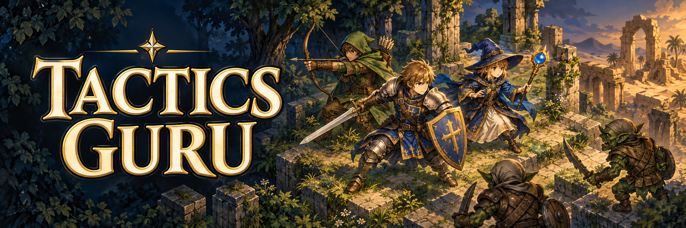
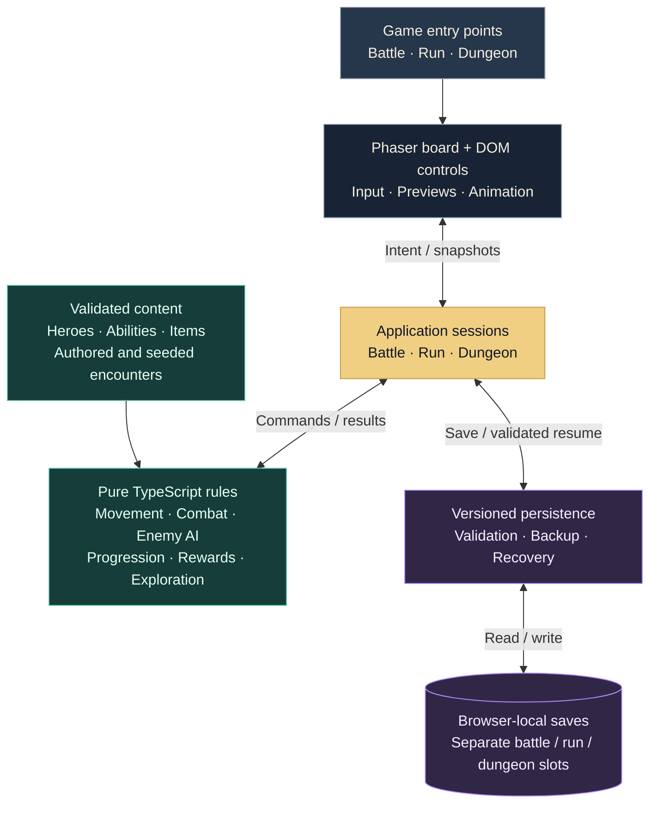

<p align="center">
  <a href="https://tactics-guru-v2.pages.dev/"></a>
  
</p>
<p align="center">
  <a href="package.json"></a>
  <a href="package.json"></a>
  <a href="package.json"></a>
  <a href="package.json"></a>
  <a href="docs/verification-policy.md"></a>
  <a href="docs/browser-testing.md"></a>
  <a href="https://github.com/luminari-gurus/tactics-guru-v2/issues"></a>
  <a href="https://github.com/luminari-gurus/tactics-guru-v2/stargazers"></a>
</p>

# Tactics Guru

**Three heroes. Elevated battlefields. One more dungeon floor.**

A browser-based fantasy tactics game built with **Phaser 4, TypeScript and Vite**.
Lead a Fighter, Ranger and Mage through turn-based battles where terrain, line of
sight and high ground matter. Explore seeded dungeon floors, choose rewards and
carry your surviving party into the next encounter.

This repository is the playable **v2 prototype**. The header is promotional art;
the game uses illustrated portraits, compact sprites and isometric tile boards.

**[Play a battle](https://tactics-guru-v2.pages.dev/) · [Enter the dungeon](https://tactics-guru-v2.pages.dev/dungeon) · [Run locally](#run-locally) · [Explore the architecture](#how-it-fits-together) · [Browse the docs](#project-guide)**

## Choose your adventure

- **[Standalone battle](https://tactics-guru-v2.pages.dev/) — `/`**<br>
  Fight the authored 12×12 Forest Ruins encounter with a level-1 party, enemy AI,
  attack previews, combat feedback and a saved battle you can continue.
- **[Three-encounter run](https://tactics-guru-v2.pages.dev/run) — `/run`**<br>
  Play two seeded Desert battles followed by the authored Ruined Approach finale.
  Carry HP, XP and equipment between encounters; choose an item after each of the
  first two victories. The third victory completes the run.
- **[Dungeon floors](https://tactics-guru-v2.pages.dev/dungeon) — `/dungeon`**<br>
  Explore Rooms layouts with fog of discovery, encounter markers and stairs.
  Floors alternate Forest and Desert after a seeded first biome. Each has a normal
  encounter, an elite or vault encounter, and a goblin guardian encounter. Clear the
  guardian to unlock descent; revisit discovered floors with their progress intact.
  Enemies scale with depth, and a party wipe ends the dungeon.
- **[Map laboratory](https://tactics-guru-v2.pages.dev/map) — `/map`**<br>
  Inspect reproducible 20×20 Rooms, Random walker or Cellular caves layouts in
  Grassland, Forest or Desert. Switch between Simple and available Legacy 8-bit
  art. This separate inspection tool has seeded markers but no movement, battles
  or saved progress.

## Meet the party

- **Fighter** — **Guarded Strike** trades accuracy for defense. In runs and dungeons,
  level 2 unlocks **Second Wind**, a once-per-battle self-heal; level 3 unlocks
  **Taunt**, restricting a hostile target's offensive choices to the living Fighter
  until that target's next turn ends.
- **Ranger** — **High Shot** rewards taking higher ground, with ranged attacks
  governed by distance and line of sight.
- **Mage** — **Magic Missile** deals automatic-hit force damage, subject to range
  and line of sight. Progression increases the missile count at levels 3 and 5.
  It can target allies, so check the friendly-fire warning before confirming.

Runs and dungeons support **levels 1–5**. Victories award XP to living participants;
level-ups increase maximum HP and heal them. Defeated heroes stay defeated.
Between encounters, use **Healing Draughts** or equip an **Aiming Charm** or
**Warding Charm**. See [hero progression](docs/hero-progression.md),
[ability rules](docs/signature-abilities.md#fighter-progression-163) and
[items and rewards](docs/run-items.md) for the exact contracts.

### Your first turn

1. Choose **Move**, **Basic attack** or a learned **Ability**, then select a tile or
   target. Hovering a possible destination previews ability reach from that tile.
2. Read the preview, then press **Confirm action** to commit. Selecting, hovering
   and cancelling leave the battle state unchanged.
3. Use **Wait / End turn** when ready; it ends the turn immediately. Enemies take
   their turns automatically.

Click or tap to select, drag to pan, and use the wheel or pinch to zoom. On the
focused battle board, arrows navigate, **Enter** selects and **Escape** cancels.
Dungeon exploration supports arrows/WASD, adjacent-cell taps and direction buttons.
Sound starts off; **Enable sound** turns on battle cues.

### Pick up where you left off

Standalone battles, runs and dungeons keep **separate browser-local saves**, with
primary/backup slots and recovery controls. Accepted progress and active battles
can survive reload; hovering and unconfirmed actions are not saved. Saves belong
to this browser and origin, with no account or cloud sync.

Save readers validate content and rules versions. Incompatible or damaged data
is retained for recovery/export instead of silently resetting progress. Export an
older save before replacing it; continuing it may require its originating build.
Storage failures are shown in the UI. See [battle storage](docs/battle-storage.md)
and [progression compatibility](docs/hero-progression.md#save-compatibility).

## Run locally

Use **Node.js 22.12 or newer** and npm; repository CI uses Node 24. Start from a Git
checkout so production builds can record their source identity.

```sh
git clone https://github.com/luminari-gurus/tactics-guru-v2.git
cd tactics-guru-v2
npm ci
npm run dev
```

Open the URL printed by Vite, then append `/run`, `/dungeon` or `/map` to explore
the other modes. No environment configuration or API keys are required to play,
build or test. Dependencies are pinned in `package-lock.json`.

```sh
npm run typecheck  # application and pure-domain TypeScript scopes
npm run build      # content validation, both typechecks, then production output
npm run preview    # serve the generated dist/ locally
```

Development and preview bind to localhost. For intentional testing on a trusted
LAN, use `npm run dev -- --host 0.0.0.0`. `dist/` is generated and ignored by Git.

<details>
<summary><strong>Hosting under a subpath</strong></summary>

Images, portraits and audio follow Vite's base path. Use the same prefix for build
and preview:

```sh
npm run build -- --base=/prototype/
npm run preview -- --base=/prototype/
```

Open `/prototype/`, `/prototype/run`, `/prototype/dungeon` or `/prototype/map`.
For development, use `npm run dev -- --base=/prototype/`. A production host must
serve `dist/` beneath that prefix and route application entries to `index.html`.
Rebuild at the root base before running the default browser suite. The
[verification policy](docs/verification-policy.md#focused-commands-and-base-paths)
documents root/prefix checks and shell-specific environment setup.

</details>

## How it fits together

Game rules live in pure TypeScript. Application sessions validate commands and
own accepted state; Phaser and the DOM present that state. Animations acknowledge
already-resolved outcomes, and previews do not spend actions or advance battle RNG.



The independent `/map` laboratory shares seeded map generation; the diagram above
shows the playable battle, run and dungeon flow.

- [`src/domain/`](src/domain/) — deterministic rules, RNG, replay, progression and save codecs.
- [`src/content/`](src/content/) — validated heroes, abilities, terrain, encounters and items.
- [`src/app/`](src/app/) — route hosts and battle/run/dungeon session orchestration.
- [`src/phaser/`](src/phaser/), [`src/geometry/`](src/geometry/), [`src/ui/`](src/ui/) — scenes, isometric projection, picking, accessible controls and feedback.
- [`src/persistence/`](src/persistence/) — guarded browser storage and recovery.
- [`src/map/`](src/map/) — seeded layouts, biomes and the standalone map view.
- [`public/`](public/) — runtime art and audio; [`docs/art/`](docs/art/) — art references and production records.
- [`tests/`](tests/) and [`scripts/`](scripts/) — unit, build and browser verification plus measurement tools.

## Verify a change

Follow the [verification policy](docs/verification-policy.md): choose checks from
the affected behavior and its consumers. Documentation-only changes need link,
path and command checks; they do not require game or browser regression runs.

```sh
npm run test:unit           # fast units, including content
npm run test:build          # real root/prefix build integrations
npm run test:unit:all       # both selections together
npm run setup:browsers      # Chromium + WebKit; install once/update as needed
npm run check:browsers
npm run build
npm run test:browser-smoke
npm test                   # default Chromium matrix; not the full regression set
```

On Linux, `npm run setup:browsers:linux` also installs required system libraries.
Use `npm test -- <filters>` for focused browser checks, `npm run test:fixtures`
for the development fixture suites, and `npm run verify:full` for explicit full
verification. Run browser workloads sequentially; the default tests serve the
production build, while fixtures and telemetry have their own configurations.

Browser coverage includes desktop, mobile portrait/landscape emulation and
separate WebKit configurations. **Playwright evidence satisfies project device
acceptance unless physical-device testing is explicitly requested.** Report the
actual engine/profile used. Browser CI uses the self-hosted runner without an
automatic GitHub-hosted fallback.

See [browser setup](docs/browser-testing.md), [serial verification](docs/serial-verification.md)
and [timing baselines](docs/verification-timings.md) for diagnostics and receipts.

<details>
<summary><strong>Diagnostic scenes and measurements</strong></summary>

- `/?scene=proof` — the retained rendering/input/audio proof scene. Open
  **Measurements** or call `window.fitDiagnostics()` in browser developer tools.
- `/?scene=content-smoke` — catalog loading and terrain-surface inspection.
- `npm run measure:fit` — after a build, collect cold/warm proof-scene measurements
  into `test-results/fit-baseline.json`, including source/build identity. This is
  a diagnostic baseline, not a complete gameplay performance certification.

These routes also respect the configured base path.

</details>

## Project guide

- **Visual identity:** [design guide](docs/DESIGN.md), [unit artwork](docs/art/unit-art-guide.md), [terrain](docs/art/terrain-textures.md), [header generation record](docs/art/readme/header-generation.json).
- **Combat:** [battle foundation](docs/battle-foundation.md), [turn flow](docs/turn-flow-combat.md), [enemy decisions](docs/enemy-turns.md), [target previews](docs/target-preview-overlays.md).
- **Adventures:** [dungeon contract](docs/dungeon.md), [run integration](docs/run-contract.md#live-integration-80), [hero progression](docs/hero-progression.md), [map laboratory](docs/overworld-map.md).
- **Persistence:** [battle save format](docs/battle-save-format.md), [storage and recovery](docs/battle-storage.md).
- **Planning:** [`openspec/`](openspec/), [ongoing project notes](docs/ongoing-projects/), [GitHub issues](https://github.com/luminari-gurus/tactics-guru-v2/issues).

Some technical documents retain dated implementation history. Their historical
limitations and future-work notes describe those revisions; current behavior is
defined by the source and current acceptance contracts.

### Privacy and optional tooling

Unconfigured builds and ordinary local development keep PostHog off. Configured
production builds can collect anonymous events and sanitized errors with a
persistent **Privacy & analytics** opt-out. Dungeon collection is currently
disabled. See the [telemetry configuration and privacy policy](docs/telemetry.md).

Optional developer media-generation tools are documented in [the media guide](docs/media-gen/README.md).
Their credentials are not required by gameplay. Treat `.env` and `.env.example`
as developer configuration and keep secrets out of commits.

### Contributing

Start with [AGENTS.md](AGENTS.md) and the [verification policy](docs/verification-policy.md).
Keep gameplay rules in the pure domain, preserve deterministic RNG and save
contracts, and record evidence for the behavior your change affects. For a bug
report, include the route, reproduction steps, browser/device profile and any
relevant seed or recovery message.
