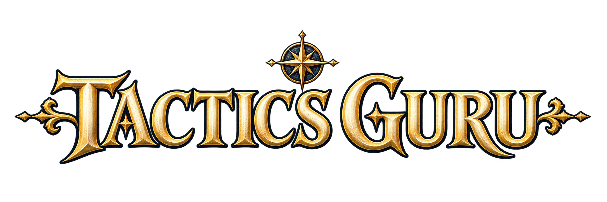
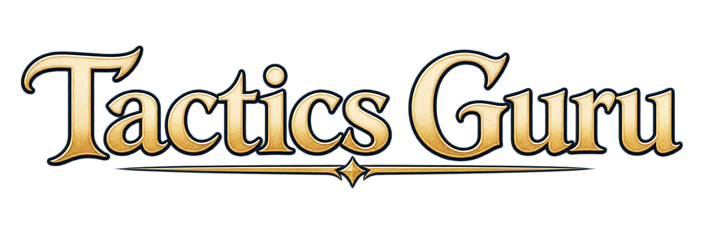

# Tactics Guru visual design

This is the starting point for the game's visual identity: typography, color, logo,
title screens, interface styling and artwork. It brings the existing guidance
together and supplies defaults where individual feature documents left choices open.

**Status, 2026-10-17:** the battle UI and art rules below consolidate existing work.
The logo, display-font and title-screen rules are new design guidance informed by
three **very rough** supplied concepts. They are a working direction, not final
artwork or evidence that a title screen or new font has shipped. This documentation
change adds no runtime assets, fonts, routes or gameplay behavior.

## Quick answer: how should the title look?

Use **Tactics Guru**, the name in the current game and all three concepts. Set a
new typeset title in **Cinzel Semibold (600)**, with an ivory face, restrained gold
edges and dark navy separation, over a quiet midnight or forest-ruin backdrop.
Use the clean proportions of concept 3 as the starting point. A small compass/star
can punctuate the identity; readable lettering takes priority over ornament.

For ordinary screen headings keep **Georgia**. For buttons, instructions, stats
and numbers keep **system sans-serif**. Use flat brass for the primary action and
warm white for ordinary text. Bevels and metallic texture belong to the large logo.

If the display font or logo image is unavailable, render the title as readable
Georgia text in flat brass. A working title and usable controls must appear without
waiting for decorative artwork.

## How to use the documents

This guide owns shared visual defaults and the new title direction. The linked
specialist documents own their detailed art, geometry, interaction and content
contracts. A styling choice must preserve those contracts. Current source describes
what is implemented; dated screenshots and QA notes describe only the revision and
states they actually tested.

The [accepted battle design](ongoing-projects/issue-108-battle-controls-design/design.md)
remains the reference for battle hierarchy and responsive placement. Its “no external
font” constraint belongs to that battle design: Cinzel is a new title/display role,
not a replacement for battle UI fonts. The
[older technical draft](tech_design.phaser4.draft.md) deliberately favored direct
entry to the board over a separate title screen. This guide describes the appearance
of a future title surface, which may also be an entry overlay; it does not insert a
mandatory extra loading or navigation step. Entry, save recovery and audio behavior
remain governed by the existing application contracts.

Some older art notes describe a 32px HUD portrait or a pre-implementation screen.
Use their asset-production rules, then check the current screen before copying a
display measurement. The current actor portrait is 60px on desktop, 48px in
portrait layouts and 40px in short landscape in [the battle stylesheet](../src/style.css).

## Reference study

These three files are preserved unchanged under `docs/art/design-references/` so
the guidance remains usable without this chat. All are 2172×724 PNGs with alpha
transparency. Dark surroundings in an image viewer are not a prescribed black
title-screen background. They show lettering and ornaments, not complete screens.
The exact fonts and production process cannot be established from these images.

### Concept 1: ceremonial lettering and compass

Keep the engraved gold/ivory material, strong dark silhouette, prominent initial
letters and navigation motif. The compass suggests journeys and tactical direction.
Reserve this density of flourishes for spacious title or promotional compositions.
Thin points, many bevels and side ornaments will compete with letters at small sizes.
The compass is an identity motif, not a promise of an in-game navigation feature.

### Concept 2: softer lettering and a single underline

Keep the broad light letter faces, softer curves and simple underline with one star.
This is useful material and warmth guidance. Its mixed-case treatment is an alternate
concept, not a second font to mix into the same wordmark. Avoid reproducing its long
underline when it would force a mobile title to shrink.

### Concept 3: restrained capitals and a separator

Use this as the **default structural direction**: strong serif capitals, generous
letter interiors, warm faces, narrow gold edges and one optional star separator.
It is the clearest starting point for a simplified or stacked title. Borrow warmth
from concept 2 and use concept 1's compass only where there is enough space. This
selection defines a design brief; none of these rough PNGs is a finished logo.

### Source record

Supplied with this design request on 2026-10-17; original attachment names were
`image-1.png`, `image-2.png` and `image-3.png`. Copies retain the original bytes;
no crop, recoloring, resampling or background removal was performed. Original font,
tool, prompt and licensing provenance were not supplied; do not invent them or
treat reference retention as approval to ship the images.

- Concept 1: 1,205,958 bytes; SHA-256 `1999b3672cc2fa7001b1479a50c0a0dd78b601175eb694ad060f1abf9f630688`.
- Concept 2: 1,304,848 bytes; SHA-256 `e1354e99f841fc585591e04f3883d66b8e8d2a6d96c7328c58b9b424d4095297`.
- Concept 3: 980,249 bytes; SHA-256 `1afa0eccefe817b3843323d2c7ec75857a7578af0fd7762abac98a9bcb5fdd93`.

## Visual character

Aim for a readable illustrated fantasy tactics game: aged brass, parchment,
midnight blue, olive foliage, worn stone and recognizable equipment silhouettes.
The identity should feel crafted and adventurous. Give the title the richest
material treatment; reduce decoration as information becomes more tactical.

The existing game intentionally combines detailed illustrated portraits, compact
softly shaded sprites and top-down terrain materials projected onto an isometric
board. Preserve that relationship. The optional legacy overworld pixel-art style
does not establish a pixel-font or pixel-art requirement for the entire game.

Use opaque or strongly backed panels wherever information needs to be read. Keep
texture out of text interiors and control surfaces. Avoid bright bloom, ornate
frames around every widget, persistent particles over the board, or miniature logo
lettering on routine controls.

## Typography

- **Brand/title display — new guidance:** `"Cinzel", Georgia, serif`, weight 600.
  Use uppercase for the primary typeset title, optical kerning and restrained
  tracking, initially `0.02em`. Start at `clamp(2.5rem, 8vw, 6rem)` and use a stacked
  two-word composition when width is limited. These are layout starting values,
  not a claim that every string fits. A custom final wordmark may refine individual
  letterforms; Cinzel is a reproducible starting family, not an identification of
  the reference font.
- **Screen and unit headings — existing direction:** `Georgia, serif`, weight 400.
  Use 24–32px for ordinary screen titles and 20–26px for important actor headings,
  adjusting within the accepted compact battle layout. Keep short headings in
  sentence/title case. Do not apply the logo's outline or metallic finish.
- **Controls and body — existing family, shared sizing guidance:**
  `system-ui, sans-serif`; 16px body/controls, 14px compact secondary copy, 12px only
  for short tertiary labels. Use 1.4–1.5 line height and 600–650 weight for action
  labels. Existing compact battle labels are sometimes smaller; the sizes here are
  defaults for new work, not a claim of a completed typography migration.
- **Numbers and feedback:** system sans-serif with tabular numerals for HP, counts
  and aligned comparisons. Use clear labels and adequate weight; monospace is for
  diagnostic IDs/seeds, not the default fantasy UI. Preserve signed damage and
  outcome wording from the real battle model.

Cinzel's [official package metadata](https://github.com/google/fonts/blob/main/ofl/cinzel/METADATA.pb)
lists a variable weight range of 400–900; its
[license file](https://github.com/google/fonts/blob/main/ofl/cinzel/OFL.txt) is SIL OFL
1.1. These were checked on 2026-10-17. A future implementation should vendor the
required font subset with its license, use WOFF2 and `font-display: swap`, and check
fallback layout. This change adds no font binary or hosted-font dependency. Keep
Georgia as a system fallback rather than copying a local operating-system font.

Brand lettering can be an image or SVG; interactive labels and explanatory copy
remain real text. Give a logo image the accessible name “Tactics Guru”; hide a
decorative duplicate when equivalent visible text already provides that name.

## Color and materials

### Shared interface palette

Use the current battle palette as the baseline for new screens. These values come
from [the accepted design](ongoing-projects/issue-108-battle-controls-design/design.md#visual-language-and-accessibility)
and [the implementation](../src/style.css); the descriptive names below are roles,
not a claim that global tokens already exist across the app.

- **Page canvas:** midnight `#101827`.
- **Panel:** `#182335`; **control surface:** `#26364b`.
- **Primary text:** warm white `#f5efdf`; **secondary text:** `#c3cbd6`.
- **Brass emphasis / primary action / focus:** `#f0cf83`.
- **Meaningful borders:** `#8d9bad`.
- **Positive status:** `#a9ddb8`; **warning or destructive emphasis:** `#ffc1ae`.

Use dark panel-colored text on a filled brass primary button. Secondary buttons
use warm white on the control surface. Selected actions need a border and explicit
selected state; focus uses a separate visible 3px outline. Disabled controls retain
readable secondary text and a visible explanation. Gold is emphasis, not a universal
“good” signal; it already identifies the acting unit and current action.

The original battle prototype measured warm white/panel at 13.75:1, secondary
text/button at 7.50:1 and dark text/brass at 10.49:1. See its
[measurement record](ongoing-projects/issue-108-battle-controls-design/previews/measurements.json).
Those results cover those pairs, not arbitrary gradients, opacity or new artwork.

### Title material palette — new guidance

Use ivory `#fff1cf` for the broad letter face, brass `#f0cf83` for the light rim,
aged gold `#c9963d` for a restrained bevel, bronze `#765022` for recessed shading
and navy `#0c1625` for the outer separation. These are chosen working colors inspired
by the concepts, not sampled values or a reconstruction of their generation settings.

Keep most of the letter face light and stable. Bevels should be narrow and highlights
should follow a consistent upper light direction. Limit shadow and outline to
separating letters from the background; avoid a thick extruded slab. Provide a flat
brass or ivory version for small sizes and single-color use. Metal gradients are
decorative logo treatments, never the sole way to communicate a control state.

### World and tactical colors

World artwork can use its own material palette within the restrained art direction.
Do not recolor every tree, stone and portrait into interface tokens. The
[overworld biome contract](overworld-map.md#layout-and-biome) owns its exact open/blocked
colors and patterns. Its current green-toned page shell and the run-item screen's
blue-white controls are existing variants; new shared styling should be adopted
deliberately when those screens are worked on, not silently declared complete here.

The [board renderer](../src/phaser/BoardRenderer.ts) currently distinguishes reachable
cells with teal `#46d7c7`, the actor with gold `#ffd36a`, and selection with an inset
white outline. Player/enemy rings use cyan `#6ddbf5` and coral `#f17a73` when not
overridden by the actor marker. Keep these roles and supporting shapes distinct.
During attack targeting, reach is replaced by green `#63eba0` check-mark diamonds
for valid targets and coral `#ff867c` X-mark diamonds for unavailable targets.
A white inner diamond plus a heavier outer border marks the selected target;
the board caption explains these shapes. See the [legacy review and preview
contract](target-preview-overlays.md).
Hypothetical movement and ability reach from the hovered tile use purple `#b48aff` fills with inset
lavender outlines and paired white dots. A small white ring marks the preview
origin. These shapes remain distinct from teal actual reach, selected diamonds
and attack check/X markers; the board caption identifies the hypothetical range.
Occupied cells are included when reachable. Legal ability targets from the preview
origin use pink `#ff82c4` fills and a white plus marker; direct action-target check/X
markers retain priority while an attack is selected.

[Unit health arcs](../src/phaser/healthBar.ts) have their own functional palette:
green `#3bc761` above 50%, amber `#e0992e` above 25% through 50%, red `#db2e29` at or
below 25%, on a `#1f211f` track. Arc length and numerical HP support the colors;
defeated units have no living-unit arc. The HUD health bar remains a separate
presentation using the UI positive color. Never equate a gold ornament or enemy ring
with a health threshold.

## Logo construction and variants

The primary name is two words: **Tactics Guru**. Preserve spelling, word order and
readable space even when a decorative star sits between them. Display capitals or
small-cap-like shapes are treatments of that name, not changes to accessible text.

Use a simple horizontal lockup when space permits. For narrow portrait layouts,
stack “Tactics” above “Guru” with a shared center and balanced optical width; do not
squeeze or stretch the horizontal image. Allow clear space of at least half the
capital height around the visible mark. Decorative tips stay inside that area.

The default large mark uses one small star separator or one compass above the name.
Do not combine a compass, central star, long underline and side flourishes by default.
Start with concept 3's readable construction and add ornament only where it improves
the composition. A compact mark may use a simplified compass/star, but show the name
nearby until that symbol has an established identity.

Aim for at least 32 CSS pixels of apparent capital height for the detailed title.
Below that, use the flat, simplified wordmark or plain text. Review actual apparent
letter size rather than the full image box, which can include large transparent
margins. These are production targets requiring visual proof, not measured limits
of the supplied concepts.

Produce separate full, simplified, stacked and single-color exports from the same
master when needed by real placements. Keep a clean editable/vector master when
available and use SVG or transparent raster exports appropriate to the artwork.
Inspect alpha on light and dark backgrounds for fringes and clipped serifs. Keep
ornament, lettering and background separable; do not bake menu text into artwork.

## Title-screen composition

This section supplies the missing composition brief. It does not claim that any
supplied concept includes a background or menu, or that the following screen exists.

**Hierarchy:** title → one primary next action → secondary actions → quiet supporting
information. Use the title in the upper or middle third of a calm composition, with
controls beneath it in a consistent column. Make the primary action visibly usable
before decoration finishes loading. Keep loading, storage-recovery and error messages
in readable backed surfaces, not painted into a scene.

**Background:** start with a painted forest-ruin setting: moss and stone, subdued
olive foliage, cool shadow and small warm highlights. A map/compass motif may appear
faintly in the environment. Reserve low-detail dark space behind the title and menu;
characters, towers, bright sky and foliage should frame that space instead of cutting
through letters. The environment should belong beside the current portraits and
terrain, with atmospheric depth but no claim of a playable location that lacks content.

**Responsive layout:** design landscape and portrait compositions intentionally.
Use 1920×1080 and 1080×1920 as source-art planning sizes, then export for actual display
and transfer needs. Keep the wordmark in a contained layer and let only background
art crop. At narrow widths stack the words; at short landscape heights reduce
ornament and vertical gaps first. Keep at least 16px safe content padding plus device
insets, allow a scrolling menu when text grows, and preserve control size. Never crop
letters, hide recovery controls or shrink the entire screen to fit.

**Controls:** use the shared flat UI palette and a restrained panel or scrim. A valid
saved session may make Continue the primary action; otherwise use the start action
supported by the chosen route. Keep labels and availability tied to the actual
[battle storage](battle-storage.md) and [run flow](run-contract.md#live-integration-80).
An unreadable save needs the existing recovery path, not a misleading Continue or
silent reset. Do not add decorative menu entries for unimplemented modes, accounts
or settings. Audio must retain user control and existing unlock behavior.

**Motion:** a brief opacity reveal or very slow background movement is enough. Do
not gate input on a logo reveal. Avoid looping shine across text or particles over
controls. Under reduced motion use a static composition and immediate usable content.
Art or font failure falls back to midnight, a text title and native controls.

Example art brief: “Illustrated fantasy tactics title backdrop, forest ruins with
mossy stone and olive foliage, cool midnight shadows with restrained warm highlights,
quiet low-detail central area reserved for a separate ivory-and-gold serif title
and menu, readable landscape and portrait composition, no lettering, buttons or
baked UI.” Supply the unit/terrain references alongside the logo concepts; the
logo images alone do not define the environment style.

## Interface and screen family

Use a 4px spacing base, normally 8px within groups, 12–16px between related blocks and
24–32px between major sections. Use 5–6px control radii, 8–12px panel/dialog radii and
thin visible boundaries. Keep decoration at headings and edges. Existing battle
geometry has more specific constraints and takes precedence over these general defaults.

- **Battle:** preserve actor → HP/status/budgets → actions → target/preview →
  Review/Cancel. Party inspection does not change the actor. Follow the accepted
  right rail/portrait dock, scrolling regions and drawable-board bounds; decorative
  headings yield space before actions or the battlefield. The title-screen logo
  should not consume the battle's information budget.
- **Run preparation, rewards and inventory:** reuse the same headings, panel surfaces
  and control roles. Show carried HP, item effect, ownership/equipment and the next
  action clearly. A reward choice needs a readable name, effect and selected state;
  decoration must not imply rarity, healing, revival or other rules absent from the
  [item](run-items.md) and [run](run-contract.md) contracts.
- **Overworld:** preserve a matching walkable/blocked legend, biome motifs, current
  art selection and honest fallback feedback. The map prototype is a distinct
  inspection surface, not an already implemented campaign-selection screen.
- **Dialogs and outcomes:** use short Georgia headings, system body text, backed
  surfaces and obvious primary/secondary actions. Keep native modal focus and input
  capture. Victory/defeat may use a restrained gold rule or emblem; retain numerical
  results, save/recovery meaning and the route's real restart/continue behavior.
- **Icons:** use simple consistent silhouettes with roughly 1.5–2px strokes at
  20–24px when new icons are needed. Pair unfamiliar action/status symbols with text.
  Compass and star decorations are not interchangeable with selection, warning or
  success icons. Do not introduce an icon library solely for a handful of ornaments.

## Characters, terrain and combat presentation

Follow the [unit art guide](art/unit-art-guide.md) and paired
[sprite](art/unit-sprite-brief.md)/[portrait](art/unit-portrait-brief.md) briefs.
Keep compact readable sprite silhouettes, shared character identity, restrained
olive/navy/leather/gold colors, and illustrated parchment-framed portraits. Existing
64×80 sprite canvases, foot anchors and 96×96 portrait exports are content contracts;
a new UI layout does not authorize resizing or replacing canonical source art.

Use the [terrain production brief](content-contract.md#terrain-production-brief),
[texture guide](art/terrain-textures.md) and [terrain review](qa/issue-27-terrain-review.md).
Terrain is top-down diffuse surface material; the renderer owns isometric projection,
height and sides. Keep foliage/props separate, compare neighboring textures at runtime
scale and inspect repeated edges. A title illustration can have cinematic perspective;
that does not change the requirements for a tile texture.

Combat effects should explain the action: blade/shield for Guarded Strike, a clear
arrow for High Shot, an orb/trail/impact for Magic Missile. Preserve distinct shape
and motion, unit attachment and readable damage/status feedback from the
[ability presentation design](../openspec/changes/issue-106-ability-animations/design.md).
Health arcs, actor rings, targets and labels must remain separable in crowded/elevated
views. Decorative animation never creates a result or independently unlocks the turn.
Reduced-motion presentation must still communicate outcomes and complete the actual
presentation lifecycle.

## Readability and acceptance

For each new or changed surface, check the actual rendered result:

- Text contrast at least 4.5:1 for routine copy; meaningful controls, boundaries and
  focus indicators at least 3:1 against adjacent colors. Keep logo highlights
  decorative and title lettering readable against every supported background crop.
- Native controls at least 44×44 CSS pixels, visible keyboard focus, logical tab
  order, focus return and modal containment. Explanations cannot require hovering
  or focusing a disabled button. Mirror pointer/touch actions with keyboard access.
- Convey selection, resources, health and errors with words, shapes, quantities or
  patterns as well as color. Preserve accessible title/control names and readable
  status updates; decorative ornaments do not enter the focus order.
- Review at 1280×720, 412×915, 915×412, 320×568 and 568×320, with 200% text, safe-area
  insets and reduced motion. Check long labels and fallback fonts. Title/menu and
  battle have different layout constraints; do not apply battle board-height rules
  to a title screen without a board.
- Capture loading, ready, hover/focus/pressed/disabled, recovery/error and relevant
  outcome states. For titles also check missing font/art, stacked/plain variants
  and alpha edges; for battle inspect moving and settled feedback at fit and zoom.

Use [the repository device policy](../AGENTS.md#device-testing-and-acceptance):
Playwright, including browser/device emulation, is sufficient unless physical-device
testing is explicitly requested for the task. Describe emulation accurately and keep
actual failures visible. A screenshot of one state is not interaction or full-screen
acceptance. Documentation and rough references do not constitute rendered acceptance.

## Production handoff and document map

For new artwork, preserve the brief/reference files and editable master; record
dimensions, alpha, exports, byte sizes, hashes, settings and known source information.
Keep unknown provenance explicit. Typeset exact title text separately when generation
does not preserve lettering. Review at intended display sizes before placing approved
exports in runtime assets. Follow the current catalog/base-path loading conventions;
documentation references under `docs/art/` are not automatically game assets.

Start with the topic below rather than treating every historical plan as a current
instruction. Update this guide when shared visual decisions change, and keep detailed
contracts and dated evidence in their owning documents.

### Battle interface and presentation

- [Accepted visual design and responsive rules](ongoing-projects/issue-108-battle-controls-design/design.md),
  [interactive mockups](ongoing-projects/issue-108-battle-controls-design/mockups.html),
  [placement sketches](ongoing-projects/issue-108-battle-controls-design/placement-options.svg)
  and [prototype captures](ongoing-projects/issue-108-battle-controls-design/previews/).
- [Responsive implementation design](../openspec/changes/issue-111-responsive-battle-controls/design.md),
  [controls specification](../openspec/specs/battle-controls/spec.md),
  [current battle CSS](../src/style.css), [HUD](../src/ui/hud.ts) and
  [runtime verification](qa/issue-111-battle-controls.md).
- [Ability presentation specification](../openspec/changes/issue-106-ability-animations/specs/battle-ability-presentation/spec.md)
  and [visual/lifecycle evidence](qa/issue-106-ability-animations.md).
- [Unit health display design](../openspec/changes/issue-121-unit-health-bars/design.md),
  [specification](../openspec/changes/issue-121-unit-health-bars/specs/unit-health-display/spec.md)
  and [screenshots/evidence](qa/issue-121-unit-health-bars.md).
- [Dialog focus evidence](qa/battle-dialog-focus.md),
  [device acceptance record](qa/device-acceptance-2026-10-17.md) and
  [current project handoff](ongoing-projects/plan.md).

### Artwork and content

- [Unit art guide](art/unit-art-guide.md), [reference sheet](art/unit-art-reference.png),
  [sprite brief](art/unit-sprite-brief.md) and [portrait brief](art/unit-portrait-brief.md).
- [Terrain textures](art/terrain-textures.md), [source prompts](art/terrain-prompts-v1.json),
  [source/export manifest](art/terrain-manifest-v1.json),
  [texture contact sheet](art/terrain-contact-v1.png) and
  [asset dimensions/anchors registry](../src/content/assets.ts).
- [Content contract](content-contract.md), [first battle content](first-battle-content.md)
  and [authored encounters](authored-encounters.md).
- [Overworld map, biomes and fallback](overworld-map.md),
  [legacy art inventory](art/issue-98/README.md), [map art design](../openspec/changes/issue-98-map-art/design.md),
  [biome design](../openspec/changes/issue-99-map-biomes/design.md) and
  [current map CSS](../src/map/style.css).
- [Media generation workflow](media-gen/README.md) and
  [visual asset resources](media-gen/visuals-resources.md). These describe production
  tools; they do not require a runtime generation service.

### Behavior that the visuals must represent

- [Battle state and previews](battle-foundation.md), [grid movement](grid-movement.md),
  [turn flow and combat](turn-flow-combat.md), [signature abilities](signature-abilities.md)
  and [session specification](../openspec/specs/battle-session/spec.md).
- [Run contract](run-contract.md), [items and reward offers](run-items.md),
  [item-control design](../openspec/changes/issue-79-reward-item-controls/design.md),
  [run progression design](../openspec/changes/issue-80-run-progression/design.md),
  [current item CSS](../src/ui/runItems.css) and [run-flow CSS](../src/ui/runFlow.css).
- [Battle storage/recovery](battle-storage.md), [save format](battle-save-format.md),
  [audio specification](../openspec/specs/battle-audio/spec.md) and
  [audio verification](qa/issue-62-battle-audio.md).
- [Restart plan](phaser4-restart-plan.md) and [technical draft](tech_design.phaser4.draft.md)
  for historical architecture, loading budgets and constraints. Read alongside the
  current implementation and later feature records, not as proof of current visuals.
