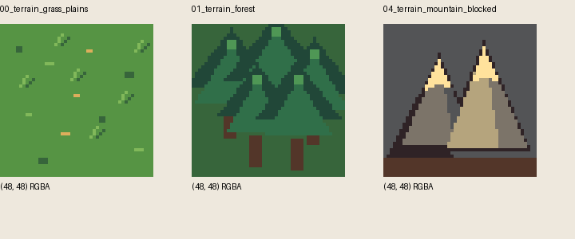

# Legacy overworld artwork inventory

Issue [#98](https://github.com/luminari-gurus/tactics-guru-v2/issues/98) can use one bounded legacy artwork style, **Legacy 8-bit** (`legacy-8bit`), alongside the default `simple`. Import three original 48px tiles; use Simple for desert and for failed assets. This inventory completes the asset selection prerequisite, not the dropdown implementation or browser acceptance.

Audited on 2026-10-13 at legacy revision [`e9433f6b608ae6b2d95418615cce9cf17dadcf74`](https://github.com/luminari-gurus/tactics-guru/tree/e9433f6b608ae6b2d95418615cce9cf17dadcf74). No newer assets selected. The recursive tree was complete (`truncated=false`). [inventory.json](inventory.json) records exact paths, Git blob IDs, SHA-256 hashes, byte sizes, PNG dimensions, alpha bounds and proposed exports for 77 downloaded files. Three selected originals and the relevant provenance records are preserved here; they are documentation assets, outside Vite's runtime public directory.

## Actual styles and available coverage

`scripts/run/OverworldScene.gd` declares `current`, `8bit_sprites`, and `ascii` and dispatches their rendering separately (lines 47–50, 1828–1877). Current uses primitive drawing; ASCII uses characters. Neither supplies another importable raster artwork set. The 8-bit style loads `art/overworld/8bit/generated/individual_48/` (lines 71 onward). Its README's initial placeholder description is superseded by the appended generated-art handoff and actual runtime paths. The handoff identifies procedural pixel art, not model-generated images.

The generated set contains 34 sprites in each of 48px and 32px, plus two atlases. These are two resolutions of **one style**, not separate styles. Grass, forest, water, mountain, roads, fog, borders, POIs and a party marker are present. Road topology, fog, POIs and party markers are outside #98's binary terrain scope. No dedicated desert tile is present; the handoff lists desert among future refinements.

Legacy `docs/asset_licenses.md` separately identifies Kenney Sketch Town copies, project-generated smooth terrain, and detailed isometric terrain using a user-provided screenshot. Exact `art/tiles/` PNG paths are listed in inventory.json. These are battle artwork families, not additional supported square overworld styles. Isometric canvases/overlays would require projection and anchor work; the detailed family also carries unresolved screenshot provenance. None is selected for this import. Existing v2 terrain artwork is independently generated and does not establish legacy style coverage.

## Bounded import set

All selected paths are relative to `art/overworld/8bit/generated/individual_48/` at the pinned revision. Preserve the `sources/` files byte for byte. Proposed runtime exports are unchanged PNG copies under `public/map-art/legacy-8bit/`, retaining the filenames.

| File | Bytes | SHA-256 |
|---|---:|---|
| `00_terrain_grass_plains.png` | 277 | `33be39d3c06656543121c0b7a0632c065fa383b327ab3fab91777364599f4f5f` |
| `01_terrain_forest.png` | 435 | `2d4674b4c7d4489893e687823614356c46e1440786fabe43cfbf1c01b0bbc013` |
| `04_terrain_mountain_blocked.png` | 406 | `b2d83e7bacccd0b2ca8b58d86e51eef4096689b3824a1f1731ec5185961f408e` |

Each source is 48×48 RGBA with full-cell alpha bounds. Use a square full-cell canvas, top-left anchor (0,0), no trim, no perspective transform, nearest/pixelated scaling and no overhang. Do not apply battle's isometric anchors. The mountain is a stylized rock obstacle with light peak highlights; it does not introduce snow terrain or a new biome.

## Six treatment mapping

| Existing terrain ID | Presentation in Legacy 8-bit | Coverage |
|---|---|---|
| `grassland-open` | Grass plains | Imported |
| `grassland-blocked` | Mountain/rock | Imported |
| `forest-open` | Grass plains as clearing | Shared imported grass; no unique clearing asset |
| `forest-blocked` | Dense forest/pines | Imported |
| `desert-open` | Simple sand | Explicit missing-art fallback |
| `desert-blocked` | Simple rock | Explicit missing-art fallback |

The v2 terrain contract defines walkability; the legacy forest sprite's previous gameplay meaning is irrelevant. All three map algorithms use this same mapping. Keep the light-open/dark-blocked Simple base beneath artwork and a consistent visible blocked outline or marker if needed for small cells. Legend swatches must use the actual treatment, including per-asset fallback. Show feedback when desert uses Simple or an image cannot load/decode; keep `legacy-8bit` selected so its fallback is understandable. Never substitute another biome or modify cells, terrain, seed, versions or RNG.

## Provenance and exports

Preserved `provenance/` contains the source README, HANDOFF, sprite manifest, deterministic stdlib generator and asset-license ledger. The generator draws its own palette and geometry and writes PNGs; its source documents no external input artwork for this set. The handoff describes it as hand-authored procedural pixel art. The license ledger has no explicit overworld entry, named creator, rights grant or SPDX identifier for these sprites. Record this as project-repository procedural art with an explicit license/creator gap; do not assert CC0 or transfer the Kenney license to it. This is not a legal clearance finding.

Source PNG bytes and hashes are authoritative. All 77 downloaded files match Git's pinned blob hashes; all 70 PNGs decode. All 34 individual 48px tiles match their atlas cells. All 34 32px copies match the generator's floor-coordinate nearest sampling, which differs from Pillow's center-coordinate nearest resize. No asset generation was run and no artwork changed.

The bounded runtime payload is **1,118 PNG bytes**, before HTTP overhead; actual transferred bytes and added JS/CSS bundle bytes must be measured after implementation. Do not export whole atlases or all 68 tiles. Resolve URLs with `import.meta.env.BASE_URL`; load only the selected style's required images from the dynamically imported map route. No map image preload or global CSS asset reference on the battle route. Treat HTTP, decode and load failures as nonfatal Simple fallback, including late responses after selection changes.

## Remaining implementation and verification

Merged #87/#97/#99 provide the map route, algorithms and six terrain meanings. The approved shared contract settles style defaults, independent generation and fallback; the selected ID and files above resolve #98's inventory gate. #96 is a parent, not a blocker. #88 concerns separate battle unit art.

Implementation affects `src/map/view.ts`, `src/map/style.css`, a small map-only style/asset module if needed, the three public exports, map tests, and `docs/overworld-map.md`. Add a native labeled Art style select and rerender the retained `BiomeMap` without generation calls or RNG draws. Preserve displayed seed input during art rerenders. Invalid seed input must retain the last valid map/selections and visible validation; Generate and New seed retain valid art selection. Avoid tying asset loading to biome generation or adding persistence/URL state.

Verify every type/biome/style combination, deterministic data identity across switching, selection retention, invalid input, keyboard/mobile controls and matching legends. Inject missing/decode failures, switch away during a pending load, and check direct navigation/refresh at root and a configured prefix. Inspect desktop and mobile 20×20 screenshots; this contact sheet alone does not certify runtime readability. Check battle startup, unchanged save keys/state, absence of map image requests on battle, and actual network/bundle sizes. Run content validation, relevant unit/browser tests, configured full tests, strict typecheck, production build and `git diff --check`. Record real results and any physical-device limitations. Application implementation remains subject to the work-work-work concrete-plan approval step.
