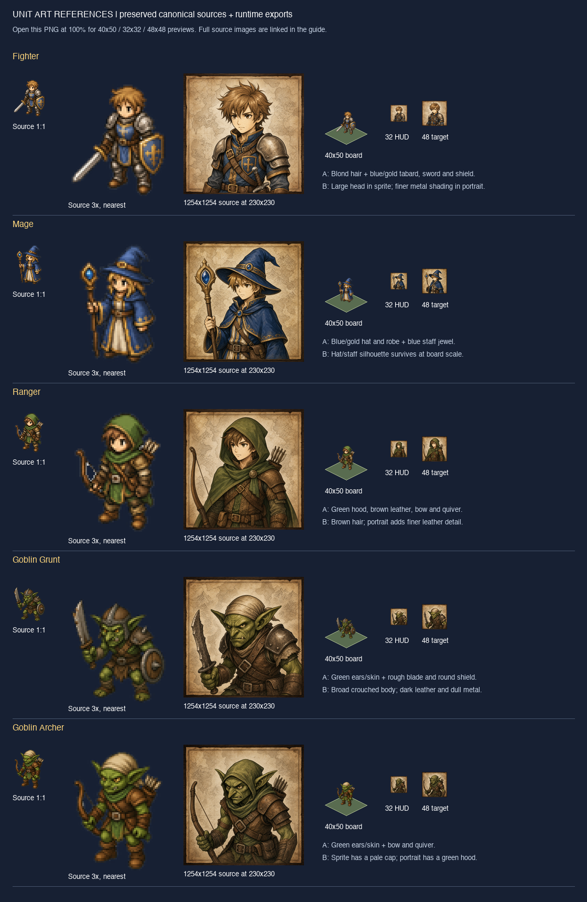

# Unit artwork guide

Use this guide and the [sprite brief](unit-sprite-brief.md) / [portrait brief](unit-portrait-brief.md) to produce a coherent player or enemy pair. This documents the five existing pairs; new guidance is labeled **Recommendation**. It does not approve new units or replace canonical artwork.

## Reference sheet and sources

[Open the sheet at original size](unit-art-reference.png) for the 1:1 sprite sources, 3× nearest-neighbor inspections, and 40×50 board / 32×32 HUD / 48×48 export-target previews. Portrait inspection thumbnails are 230×230 from 1254×1254 sources; open the source links below to inspect their full resolution. The tile previews use an 80×40 diagnostic diamond at board scale 1, with the registered foot anchor. They illustrate size/placement, not a screenshot or physical-device readability certification. Phaser filtering, camera scale and device density can change the final sampling.

All ten sources are preserved from `luminari-gurus/tactics-guru` revision `9303d9916d99e7bf4ecda36b55fbb038983af834`. The [asset registry](../../src/content/assets.ts) records original paths, full SHA-256 hashes, dimensions, anchors and runtime exports. The sheet uses these exact source files and registered runtime PNGs; no source artwork was altered. Source links below point to the preserved copies, whose hashes were checked against that registry.

| Pair / asset IDs (`asset:` prefix) | Preserved sprite | Preserved portrait | Runtime portrait | Legacy originals at pinned revision |
| --- | --- | --- | --- | --- |
| Fighter: `fighter_sprite`, `fighter_portrait` | [64×80](../../public/proof/fighter.png) | [1254×1254](../../public/proof/fighter-portrait.png) | [96×96](../../public/battle/portraits/fighter.png) | [sprite](https://github.com/luminari-gurus/tactics-guru/blob/9303d9916d99e7bf4ecda36b55fbb038983af834/art/units/fighter.png), [portrait](https://github.com/luminari-gurus/tactics-guru/blob/9303d9916d99e7bf4ecda36b55fbb038983af834/art/portraits/fighter_portrait.png) |
| Mage: `mage_sprite`, `mage_portrait` | [64×80](../../public/battle/source/mage_sprite.png) | [1254×1254](../../public/battle/source/mage_portrait.png) | [96×96](../../public/battle/portraits/mage.png) | [sprite](https://github.com/luminari-gurus/tactics-guru/blob/9303d9916d99e7bf4ecda36b55fbb038983af834/art/units/mage.png), [portrait](https://github.com/luminari-gurus/tactics-guru/blob/9303d9916d99e7bf4ecda36b55fbb038983af834/art/portraits/mage_portrait.png) |
| Ranger: `ranger_sprite`, `ranger_portrait` | [64×80](../../public/battle/source/ranger_sprite.png) | [1254×1254](../../public/battle/source/ranger_portrait.png) | [96×96](../../public/battle/portraits/ranger.png) | [sprite](https://github.com/luminari-gurus/tactics-guru/blob/9303d9916d99e7bf4ecda36b55fbb038983af834/art/units/ranger.png), [portrait](https://github.com/luminari-gurus/tactics-guru/blob/9303d9916d99e7bf4ecda36b55fbb038983af834/art/portraits/ranger_portrait.png) |
| Goblin Grunt: `goblin_grunt_sprite`, `goblin_grunt_portrait` | [64×80](../../public/battle/source/goblin_grunt_sprite.png) | [1254×1254](../../public/battle/source/goblin_grunt_portrait.png) | [96×96](../../public/battle/portraits/goblin_grunt.png) | [sprite](https://github.com/luminari-gurus/tactics-guru/blob/9303d9916d99e7bf4ecda36b55fbb038983af834/art/units/goblin_grunt.png), [portrait](https://github.com/luminari-gurus/tactics-guru/blob/9303d9916d99e7bf4ecda36b55fbb038983af834/art/portraits/goblin_grunt_portrait.png) |
| Goblin Archer: `goblin_archer_sprite`, `goblin_archer_portrait` | [64×80](../../public/battle/source/goblin_archer_sprite.png) | [1254×1254](../../public/battle/source/goblin_archer_portrait.png) | [96×96](../../public/battle/portraits/goblin_archer.png) | [sprite](https://github.com/luminari-gurus/tactics-guru/blob/9303d9916d99e7bf4ecda36b55fbb038983af834/art/units/goblin_archer.png), [portrait](https://github.com/luminari-gurus/tactics-guru/blob/9303d9916d99e7bf4ecda36b55fbb038983af834/art/portraits/goblin_archer_portrait.png) |

Hobgoblin Warrior (`hobgoblin_warrior_sprite` / `hobgoblin_warrior_portrait`) and Goblin Shaman (`goblin_shaman_sprite` / `goblin_shaman_portrait`) now follow the same illustrated sprite/portrait convention as the goblin pairs: 64×80 RGBA sprites with foot anchor (32,76), and a 1254×1254 framed portrait source with a 96×96 runtime export. Hobgoblin previously derived its 96×96 portrait from a 48×48 nearest-neighbor crop of a pixel-art sprite; that exception is removed. They are not on the five-pair annotated sheet, which remains the original #88 reference.

Bestiary batch 1 adds five more illustrated goblin-family pairs with the same convention and foot anchor (32,76). They are registered as optional enemy units and packaged as ordinary Git blobs; they are not on the five-pair annotated sheet and are not placed into existing battles or dungeon encounter rosters.

| Pair / asset IDs (`asset:` prefix) | Sprite | Portrait source | Runtime portrait |
| --- | --- | --- | --- |
| Bramble Goblin: `bramble_goblin_sprite`, `bramble_goblin_portrait` | [64×80](../../public/battle/source/bramble_goblin_sprite.png) | [1254×1254](../../public/battle/source/bramble_goblin_portrait.png) | [96×96](../../public/battle/portraits/bramble_goblin.png) |
| Goblin Snarehand: `goblin_snarehand_sprite`, `goblin_snarehand_portrait` | [64×80](../../public/battle/source/goblin_snarehand_sprite.png) | [1254×1254](../../public/battle/source/goblin_snarehand_portrait.png) | [96×96](../../public/battle/portraits/goblin_snarehand.png) |
| Mire Goblin: `mire_goblin_sprite`, `mire_goblin_portrait` | [64×80](../../public/battle/source/mire_goblin_sprite.png) | [1254×1254](../../public/battle/source/mire_goblin_portrait.png) | [96×96](../../public/battle/portraits/mire_goblin.png) |
| Coal Goblin: `coal_goblin_sprite`, `coal_goblin_portrait` | [64×80](../../public/battle/source/coal_goblin_sprite.png) | [1254×1254](../../public/battle/source/coal_goblin_portrait.png) | [96×96](../../public/battle/portraits/coal_goblin.png) |
| Ruin Lookout: `ruin_lookout_sprite`, `ruin_lookout_portrait` | [64×80](../../public/battle/source/ruin_lookout_sprite.png) | [1254×1254](../../public/battle/source/ruin_lookout_portrait.png) | [96×96](../../public/battle/portraits/ruin_lookout.png) |

Measured half-open sprite alpha bounds: Bramble Goblin (8,12,56,80); Goblin Snarehand (7,12,58,80); Mire Goblin (7,8,57,80); Coal Goblin (6,12,59,80); Ruin Lookout (7,12,57,80). All five keep feet on the bottom edge. No `pixelArt` / nearest-neighbor Phaser special case is recorded or added.

Bestiary batch 2 adds five illustrated forest-family pairs with the same convention and foot anchor (32,76). They are registered as optional enemy units and packaged as ordinary Git blobs; they are not on the five-pair annotated sheet and are not placed into existing battles or dungeon encounter rosters.

| Pair / asset IDs (`asset:` prefix) | Sprite | Portrait source | Runtime portrait |
| --- | --- | --- | --- |
| Briar Thrall: `briar_thrall_sprite`, `briar_thrall_portrait` | [64×80](../../public/battle/source/briar_thrall_sprite.png) | [1254×1254](../../public/battle/source/briar_thrall_portrait.png) | [96×96](../../public/battle/portraits/briar_thrall.png) |
| Rotcap Sprout: `rotcap_sprout_sprite`, `rotcap_sprout_portrait` | [64×80](../../public/battle/source/rotcap_sprout_sprite.png) | [1254×1254](../../public/battle/source/rotcap_sprout_portrait.png) | [96×96](../../public/battle/portraits/rotcap_sprout.png) |
| Spore Acolyte: `spore_acolyte_sprite`, `spore_acolyte_portrait` | [64×80](../../public/battle/source/spore_acolyte_sprite.png) | [1254×1254](../../public/battle/source/spore_acolyte_portrait.png) | [96×96](../../public/battle/portraits/spore_acolyte.png) |
| Thornback Beetle: `thornback_beetle_sprite`, `thornback_beetle_portrait` | [64×80](../../public/battle/source/thornback_beetle_sprite.png) | [1254×1254](../../public/battle/source/thornback_beetle_portrait.png) | [96×96](../../public/battle/portraits/thornback_beetle.png) |
| Blob: `blob_sprite`, `blob_portrait` | [64×80](../../public/battle/source/blob_sprite.png) | [1254×1254](../../public/battle/source/blob_portrait.png) | [96×96](../../public/battle/portraits/blob.png) |

Measured half-open sprite alpha bounds: Briar Thrall (7,10,57,80); Rotcap Sprout (9,24,55,80); Spore Acolyte (7,12,57,80); Thornback Beetle (4,20,61,80); Blob (5,26,59,80). All five keep feet on the bottom edge. No `pixelArt` / nearest-neighbor Phaser special case is recorded or added.

Bestiary batch 3 adds five more illustrated forest-family pairs with the same convention and foot anchor (32,76). They are registered as optional enemy units and packaged as ordinary Git blobs; they are not on the five-pair annotated sheet and are not placed into existing battles or dungeon encounter rosters.

| Pair / asset IDs (`asset:` prefix) | Sprite | Portrait source | Runtime portrait |
| --- | --- | --- | --- |
| Cinder Archer: `cinder_archer_sprite`, `cinder_archer_portrait` | [64×80](../../public/battle/source/cinder_archer_sprite.png) | [1254×1254](../../public/battle/source/cinder_archer_portrait.png) | [96×96](../../public/battle/portraits/cinder_archer.png) |
| Ash Hound: `ash_hound_sprite`, `ash_hound_portrait` | [64×80](../../public/battle/source/ash_hound_sprite.png) | [1254×1254](../../public/battle/source/ash_hound_portrait.png) | [96×96](../../public/battle/portraits/ash_hound.png) |
| Bellows Imp: `bellows_imp_sprite`, `bellows_imp_portrait` | [64×80](../../public/battle/source/bellows_imp_sprite.png) | [1254×1254](../../public/battle/source/bellows_imp_portrait.png) | [96×96](../../public/battle/portraits/bellows_imp.png) |
| Mossback Boar: `mossback_boar_sprite`, `mossback_boar_portrait` | [64×80](../../public/battle/source/mossback_boar_sprite.png) | [1254×1254](../../public/battle/source/mossback_boar_portrait.png) | [96×96](../../public/battle/portraits/mossback_boar.png) |
| Rootling Skirmisher: `rootling_skirmisher_sprite`, `rootling_skirmisher_portrait` | [64×80](../../public/battle/source/rootling_skirmisher_sprite.png) | [1254×1254](../../public/battle/source/rootling_skirmisher_portrait.png) | [96×96](../../public/battle/portraits/rootling_skirmisher.png) |

Measured half-open sprite alpha bounds: Cinder Archer (8,12,56,80); Ash Hound (3,20,61,80); Bellows Imp (8,16,56,80); Mossback Boar (5,16,60,80); Rootling Skirmisher (6,12,59,80). All five keep feet on the bottom edge. No `pixelArt` / nearest-neighbor Phaser special case is recorded or added.

Bestiary batch 4 adds the last five non-boss illustrated forest-family pairs with the same convention and foot anchor (32,76). They are registered as optional enemy units and packaged as ordinary Git blobs; they are not on the five-pair annotated sheet and are not placed into existing battles or dungeon encounter rosters.

| Pair / asset IDs (`asset:` prefix) | Sprite | Portrait source | Runtime portrait |
| --- | --- | --- | --- |
| Thornhide Warg: `thornhide_warg_sprite`, `thornhide_warg_portrait` | [64×80](../../public/battle/source/thornhide_warg_sprite.png) | [1254×1254](../../public/battle/source/thornhide_warg_portrait.png) | [96×96](../../public/battle/portraits/thornhide_warg.png) |
| Grove Hexer: `grove_hexer_sprite`, `grove_hexer_portrait` | [64×80](../../public/battle/source/grove_hexer_sprite.png) | [1254×1254](../../public/battle/source/grove_hexer_portrait.png) | [96×96](../../public/battle/portraits/grove_hexer.png) |
| Ancient Treantling: `ancient_treantling_sprite`, `ancient_treantling_portrait` | [64×80](../../public/battle/source/ancient_treantling_sprite.png) | [1254×1254](../../public/battle/source/ancient_treantling_portrait.png) | [96×96](../../public/battle/portraits/ancient_treantling.png) |
| Owlbear Forager: `owlbear_forager_sprite`, `owlbear_forager_portrait` | [64×80](../../public/battle/source/owlbear_forager_sprite.png) | [1254×1254](../../public/battle/source/owlbear_forager_portrait.png) | [96×96](../../public/battle/portraits/owlbear_forager.png) |
| Ivybound Knight: `ivybound_knight_sprite`, `ivybound_knight_portrait` | [64×80](../../public/battle/source/ivybound_knight_sprite.png) | [1254×1254](../../public/battle/source/ivybound_knight_portrait.png) | [96×96](../../public/battle/portraits/ivybound_knight.png) |

Measured half-open sprite alpha bounds: Thornhide Warg (5,16,59,80); Grove Hexer (9,12,55,80); Ancient Treantling (10,6,54,80); Owlbear Forager (5,14,60,80); Ivybound Knight (7,8,57,80). All five keep feet on the bottom edge. No `pixelArt` / nearest-neighbor Phaser special case is recorded or added.

Bestiary batch 5 adds the first larger forest-boss pairs. They occupy a single tile, use a 96×120 RGBA canvas (1.5× the ordinary 64×80 source) with foot anchor (48,114), and load at native board size 60×75 (the same 5/8 pixels-per-source-pixel scale as 64×80 → 40×50). They are not stretched from 64×80, not squashed to 40×50, and have no `pixelArt` / nearest-neighbor Phaser special case. They are registered as optional enemy units and packaged as ordinary Git blobs; they are not on the five-pair annotated sheet and are not placed into existing battles or dungeon encounter rosters. Underdeep Caverns “Hollow Matriarch” (`hollow_matriarch_boss`) is a different unit and is not this pair.

| Pair / asset IDs (`asset:` prefix) | Sprite | Portrait source | Runtime portrait |
| --- | --- | --- | --- |
| Hollow Root Matriarch: `hollow_root_matriarch_sprite`, `hollow_root_matriarch_portrait` | [96×120](../../public/battle/source/hollow_root_matriarch_sprite.png) | [1254×1254](../../public/battle/source/hollow_root_matriarch_portrait.png) | [96×96](../../public/battle/portraits/hollow_root_matriarch.png) |
| Ironmaw Furnace Beast: `ironmaw_furnace_beast_sprite`, `ironmaw_furnace_beast_portrait` | [96×120](../../public/battle/source/ironmaw_furnace_beast_sprite.png) | [1254×1254](../../public/battle/source/ironmaw_furnace_beast_portrait.png) | [96×96](../../public/battle/portraits/ironmaw_furnace_beast.png) |
| Green Warden: `green_warden_sprite`, `green_warden_portrait` | [96×120](../../public/battle/source/green_warden_sprite.png) | [1254×1254](../../public/battle/source/green_warden_portrait.png) | [96×96](../../public/battle/portraits/green_warden.png) |

Measured half-open sprite alpha bounds: Hollow Root Matriarch (9,8,87,120); Ironmaw Furnace Beast (6,14,91,120); Green Warden (11,10,86,120). All three keep feet on the bottom edge.

Bestiary batch 6 adds five illustrated wetlands-family pairs with the ordinary 64×80 convention and foot anchor (32,76). They are registered as optional enemy units and packaged as ordinary Git blobs; they are not on the five-pair annotated sheet and are not placed into existing battles or dungeon encounter rosters. Mire Goblin is also a Wetlands unit, but remains in the goblin-family catalog from batch 1.

| Pair / asset IDs (`asset:` prefix) | Sprite | Portrait source | Runtime portrait |
| --- | --- | --- | --- |
| Lantern Imp: `lantern_imp_sprite`, `lantern_imp_portrait` | [64×80](../../public/battle/source/lantern_imp_sprite.png) | [1254×1254](../../public/battle/source/lantern_imp_portrait.png) | [96×96](../../public/battle/portraits/lantern_imp.png) |
| Bog Gnawer: `bog_gnawer_sprite`, `bog_gnawer_portrait` | [64×80](../../public/battle/source/bog_gnawer_sprite.png) | [1254×1254](../../public/battle/source/bog_gnawer_portrait.png) | [96×96](../../public/battle/portraits/bog_gnawer.png) |
| Fenstalker: `fenstalker_sprite`, `fenstalker_portrait` | [64×80](../../public/battle/source/fenstalker_sprite.png) | [1254×1254](../../public/battle/source/fenstalker_portrait.png) | [96×96](../../public/battle/portraits/fenstalker.png) |
| Mire Hexer: `mire_hexer_sprite`, `mire_hexer_portrait` | [64×80](../../public/battle/source/mire_hexer_sprite.png) | [1254×1254](../../public/battle/source/mire_hexer_portrait.png) | [96×96](../../public/battle/portraits/mire_hexer.png) |
| Bog Leech Swarm: `bog_leech_swarm_sprite`, `bog_leech_swarm_portrait` | [64×80](../../public/battle/source/bog_leech_swarm_sprite.png) | [1254×1254](../../public/battle/source/bog_leech_swarm_portrait.png) | [96×96](../../public/battle/portraits/bog_leech_swarm.png) |

Measured half-open sprite alpha bounds: Lantern Imp (11,14,53,80); Bog Gnawer (9,18,55,80); Fenstalker (12,10,52,80); Mire Hexer (7,10,58,80); Bog Leech Swarm (2,33,62,80). All five keep feet on the bottom edge. No `pixelArt` / nearest-neighbor Phaser special case is recorded or added.

Bestiary batch 7 adds five more illustrated wetlands-family pairs with the same convention and foot anchor (32,76). They are registered as optional enemy units and packaged as ordinary Git blobs; they are not on the five-pair annotated sheet and are not placed into existing battles or dungeon encounter rosters.

| Pair / asset IDs (`asset:` prefix) | Sprite | Portrait source | Runtime portrait |
| --- | --- | --- | --- |
| Marsh Croaker: `marsh_croaker_sprite`, `marsh_croaker_portrait` | [64×80](../../public/battle/source/marsh_croaker_sprite.png) | [1254×1254](../../public/battle/source/marsh_croaker_portrait.png) | [96×96](../../public/battle/portraits/marsh_croaker.png) |
| Siltback Turtle: `siltback_turtle_sprite`, `siltback_turtle_portrait` | [64×80](../../public/battle/source/siltback_turtle_sprite.png) | [1254×1254](../../public/battle/source/siltback_turtle_portrait.png) | [96×96](../../public/battle/portraits/siltback_turtle.png) |
| Fen Strider: `fen_strider_sprite`, `fen_strider_portrait` | [64×80](../../public/battle/source/fen_strider_sprite.png) | [1254×1254](../../public/battle/source/fen_strider_portrait.png) | [96×96](../../public/battle/portraits/fen_strider.png) |
| Reed Whisperer: `reed_whisperer_sprite`, `reed_whisperer_portrait` | [64×80](../../public/battle/source/reed_whisperer_sprite.png) | [1254×1254](../../public/battle/source/reed_whisperer_portrait.png) | [96×96](../../public/battle/portraits/reed_whisperer.png) |
| Swamp Stalker: `swamp_stalker_sprite`, `swamp_stalker_portrait` | [64×80](../../public/battle/source/swamp_stalker_sprite.png) | [1254×1254](../../public/battle/source/swamp_stalker_portrait.png) | [96×96](../../public/battle/portraits/swamp_stalker.png) |

Measured half-open sprite alpha bounds: Marsh Croaker (2,27,62,80); Siltback Turtle (2,31,62,80); Fen Strider (11,4,54,80); Reed Whisperer (16,10,48,80); Swamp Stalker (7,14,58,80). All five keep feet on the bottom edge. No `pixelArt` / nearest-neighbor Phaser special case is recorded or added.

Bestiary batch 8 adds three more illustrated wetlands-family pairs with the same convention and foot anchor (32,76), including Fen Hag, Rotbloom Tendril, and Drowned Warden, which the supplement labels Elite. They stay on the ordinary 64×80 canvas rather than the forest-boss 96×120 size. They are registered as optional enemy units and packaged as ordinary Git blobs; they are not on the five-pair annotated sheet and are not placed into existing battles or dungeon encounter rosters.

| Pair / asset IDs (`asset:` prefix) | Sprite | Portrait source | Runtime portrait |
| --- | --- | --- | --- |
| Fen Hag: `fen_hag_sprite`, `fen_hag_portrait` | [64×80](../../public/battle/source/fen_hag_sprite.png) | [1254×1254](../../public/battle/source/fen_hag_portrait.png) | [96×96](../../public/battle/portraits/fen_hag.png) |
| Rotbloom Tendril: `rotbloom_tendril_sprite`, `rotbloom_tendril_portrait` | [64×80](../../public/battle/source/rotbloom_tendril_sprite.png) | [1254×1254](../../public/battle/source/rotbloom_tendril_portrait.png) | [96×96](../../public/battle/portraits/rotbloom_tendril.png) |
| Drowned Warden: `drowned_warden_sprite`, `drowned_warden_portrait` | [64×80](../../public/battle/source/drowned_warden_sprite.png) | [1254×1254](../../public/battle/source/drowned_warden_portrait.png) | [96×96](../../public/battle/portraits/drowned_warden.png) |

Measured half-open sprite alpha bounds: Fen Hag (10,4,55,80); Rotbloom Tendril (2,14,62,80); Drowned Warden (15,10,50,80). All three keep feet on the bottom edge. No `pixelArt` / nearest-neighbor Phaser special case is recorded or added.

Bestiary batch 9 adds the first larger wetlands-boss pairs. They occupy a single tile, use a 96×120 RGBA canvas (1.5× the ordinary 64×80 source) with foot anchor (48,114), and load at native board size 60×75 — the same per-unit sizing as forest bosses (`unitArtSize` / `unitOverlayOffsets`). They are not stretched from 64×80, not squashed to 40×50, and have no `pixelArt` / nearest-neighbor Phaser special case. They are registered as optional enemy units in the wetlands-family catalog and packaged as ordinary Git blobs; they are not on the five-pair annotated sheet and are not placed into existing battles or dungeon encounter rosters. Fen Hag (`fen_hag`) is a different unit and is not this pair.

| Pair / asset IDs (`asset:` prefix) | Sprite | Portrait source | Runtime portrait |
| --- | --- | --- | --- |
| Lantern Hag: `lantern_hag_sprite`, `lantern_hag_portrait` | [96×120](../../public/battle/source/lantern_hag_sprite.png) | [1254×1254](../../public/battle/source/lantern_hag_portrait.png) | [96×96](../../public/battle/portraits/lantern_hag.png) |
| Maw of the Fen: `maw_of_the_fen_sprite`, `maw_of_the_fen_portrait` | [96×120](../../public/battle/source/maw_of_the_fen_sprite.png) | [1254×1254](../../public/battle/source/maw_of_the_fen_portrait.png) | [96×96](../../public/battle/portraits/maw_of_the_fen.png) |

Measured half-open sprite alpha bounds: Lantern Hag (8,13,87,120); Maw of the Fen (3,23,93,120). Both keep feet on the bottom edge.

Bestiary batch 10 adds the illustrated Underdeep Caverns family. Ten units use the ordinary 64×80 convention and foot anchor (32,76), including Cave Troll, which the supplement labels Elite but stays on the ordinary canvas rather than the forest-boss 96×120 size. Hollow Matriarch (`hollow_matriarch_boss`) occupies a single tile, uses a 96×120 RGBA canvas (1.5× the ordinary 64×80 source) with foot anchor (48,114), and loads at native board size 60×75 — the same per-unit sizing as forest bosses (`unitArtSize` / `unitOverlayOffsets`) and wetlands bosses. It is not stretched from 64×80, not squashed to 40×50, and has no `pixelArt` / nearest-neighbor Phaser special case. Forest Hollow Root Matriarch (`hollow_root_matriarch`) is a different unit and is not this pair. They are registered as optional enemy units in a new caverns-family catalog and packaged as ordinary Git blobs; they are not on the five-pair annotated sheet and are not placed into existing battles or dungeon encounter rosters.

| Pair / asset IDs (`asset:` prefix) | Sprite | Portrait source | Runtime portrait |
| --- | --- | --- | --- |
| Cave Skulk: `cave_skulk_sprite`, `cave_skulk_portrait` | [64×80](../../public/battle/source/cave_skulk_sprite.png) | [1254×1254](../../public/battle/source/cave_skulk_portrait.png) | [96×96](../../public/battle/portraits/cave_skulk.png) |
| Spore Mite Cluster: `spore_mite_cluster_sprite`, `spore_mite_cluster_portrait` | [64×80](../../public/battle/source/spore_mite_cluster_sprite.png) | [1254×1254](../../public/battle/source/spore_mite_cluster_portrait.png) | [96×96](../../public/battle/portraits/spore_mite_cluster.png) |
| Tunnel Beetle: `tunnel_beetle_sprite`, `tunnel_beetle_portrait` | [64×80](../../public/battle/source/tunnel_beetle_sprite.png) | [1254×1254](../../public/battle/source/tunnel_beetle_portrait.png) | [96×96](../../public/battle/portraits/tunnel_beetle.png) |
| Fungus Slinger: `fungus_slinger_sprite`, `fungus_slinger_portrait` | [64×80](../../public/battle/source/fungus_slinger_sprite.png) | [1254×1254](../../public/battle/source/fungus_slinger_portrait.png) | [96×96](../../public/battle/portraits/fungus_slinger.png) |
| Echo Bat Swarm: `echo_bat_swarm_sprite`, `echo_bat_swarm_portrait` | [64×80](../../public/battle/source/echo_bat_swarm_sprite.png) | [1254×1254](../../public/battle/source/echo_bat_swarm_portrait.png) | [96×96](../../public/battle/portraits/echo_bat_swarm.png) |
| Deep Delver: `deep_delver_sprite`, `deep_delver_portrait` | [64×80](../../public/battle/source/deep_delver_sprite.png) | [1254×1254](../../public/battle/source/deep_delver_portrait.png) | [96×96](../../public/battle/portraits/deep_delver.png) |
| Crystal Hermit: `crystal_hermit_sprite`, `crystal_hermit_portrait` | [64×80](../../public/battle/source/crystal_hermit_sprite.png) | [1254×1254](../../public/battle/source/crystal_hermit_portrait.png) | [96×96](../../public/battle/portraits/crystal_hermit.png) |
| Cave Troll: `cave_troll_sprite`, `cave_troll_portrait` | [64×80](../../public/battle/source/cave_troll_sprite.png) | [1254×1254](../../public/battle/source/cave_troll_portrait.png) | [96×96](../../public/battle/portraits/cave_troll.png) |
| Mycelial Shepherd: `mycelial_shepherd_sprite`, `mycelial_shepherd_portrait` | [64×80](../../public/battle/source/mycelial_shepherd_sprite.png) | [1254×1254](../../public/battle/source/mycelial_shepherd_portrait.png) | [96×96](../../public/battle/portraits/mycelial_shepherd.png) |
| Chasm Drake: `chasm_drake_sprite`, `chasm_drake_portrait` | [64×80](../../public/battle/source/chasm_drake_sprite.png) | [1254×1254](../../public/battle/source/chasm_drake_portrait.png) | [96×96](../../public/battle/portraits/chasm_drake.png) |
| Hollow Matriarch: `hollow_matriarch_boss_sprite`, `hollow_matriarch_boss_portrait` | [96×120](../../public/battle/source/hollow_matriarch_boss_sprite.png) | [1254×1254](../../public/battle/source/hollow_matriarch_boss_portrait.png) | [96×96](../../public/battle/portraits/hollow_matriarch_boss.png) |

Measured half-open sprite alpha bounds: Cave Skulk (2,4,62,80); Spore Mite Cluster (3,26,61,80); Tunnel Beetle (4,26,61,80); Fungus Slinger (2,4,62,80); Echo Bat Swarm (3,18,62,80); Deep Delver (10,14,55,80); Crystal Hermit (12,8,52,80); Cave Troll (4,10,61,80); Mycelial Shepherd (10,8,54,80); Chasm Drake (8,14,57,80); Hollow Matriarch (6,8,90,120). All eleven keep feet on the bottom edge. No `pixelArt` / nearest-neighbor Phaser special case is recorded or added.

Canonical sources are owner-repository project artwork. No per-file third-party license, original prompt, model or generation method is recorded. Retain that uncertainty; these briefs are new production instructions, not reconstructed original prompts or a rights clearance.

## Observed visual language

Sprites are compact, softly shaded raster figures with enlarged heads, short limbs, dark contour separation and a readable full-body equipment silhouette. They have visible pixel-scale detail at 64×80; the sheet enlarges them with nearest-neighbor sampling to expose it. Avoid inferring a strict pixel-art palette or uniform one-pixel outline: shaded edges include intermediate alpha/color values. Faces use a few high-contrast marks; tiny buckles and ornament are subordinate to hat/hood, weapon, shield and body shape.

Portraits use much finer illustrated linework and layered shading, with more natural head/body proportions than sprites. All five show head and upper torso inside a thin dark brown decorative frame over warm mottled parchment. Faces and equipment overlap that background; the frame remains visible. Their generally frontal or slight three-quarter pose reads toward the viewer. Sprites are upright front/three-quarter figures on the isometric board, rather than top-down silhouettes or perspective-baked terrain diamonds. One static facing is observed; no directional or animation contract is inferred.

The palette is restrained: olive greens, navy blues, brown leather, aged gold and gray metal. Highlights on upper-facing hair, hats and armor and darker undersides suggest soft overhead illumination; there is no verified universal light angle. Sprites use stronger simplification, portraits finer material detail. Preserve broad light/dark masses at small size instead of copying every portrait hatch into a sprite.

| Sheet annotation | Shared identity to preserve | Meaningful differences / review cue |
| --- | --- | --- |
| Fighter A/B | Blond tousled hair; blue/gold clothing; silver shoulder armor; sword and blue/gold shield | Sprite weapon and shield form the silhouette. Portrait crops the body and adds metal texture and straps. |
| Mage A/B | Blond hair; large blue/gold pointed hat; blue robe/cloak; staff with blue jewel | Hat height and staff are more useful at board size than fine embroidered borders. |
| Ranger A/B | Brown hair; olive hood and cloak; brown leather; bow and quiver | Hood and bow distinguish Ranger from Mage despite similar compact bodies. |
| Goblin Grunt A/B | Green skin, long pointed ears; stocky/crouched body; rough blade, round shield, dull armor | Portrait emphasizes angular face and teeth; sprite depends on ears, broad shoulders and shield. |
| Goblin Archer A/B | Green skin, long ears; slimmer archer silhouette; brown equipment, bow and quiver | Existing sprite has a pale cap; portrait has a green hood. Do not silently standardize this source mismatch. |

**Recommendation:** For new pairs, lock the same face/species, hair or head covering, clothing layers, weapon type, accent placement and distinguishing marks in a single shared identity block. The portrait may crop a weapon but should retain a visible recognizable part. Simplify detail and exaggerate key equipment in the sprite without changing character identity. Palette accents, species, build and equipment can vary by brief; framing, scale, edge treatment and rendering language should remain consistent. Player/enemy role alone does not require a new rendering style or a red/blue team recolor.

## Canvas, anchor and export contract

These values were checked on main base `d15caca` against [assets](../../src/content/assets.ts), [board rendering](../../src/phaser/BoardRenderer.ts), [unit geometry](../../src/geometry/canopy.ts), [tile geometry](../../src/geometry/iso.ts), [HUD](../../src/ui/hud.ts), and the [portrait export rule](../qa/issue-35-proof-asset-export.md).

| Property | Observed current convention | Guidance for new work |
| --- | --- | --- |
| Sprite source/runtime | 64×80 PNG default, transparent background; sources are loaded unchanged. Forest bosses use a 96×120 RGBA canvas (1.5× that source) loaded at native size | Preserve editable/high-resolution masters separately if used. Deliver a reviewed 64×80 RGBA runtime export unless the unit is an approved 96×120 boss. Do not resize/crop existing sources, and do not stretch a 64×80 sprite to 96×120 at runtime. |
| Foot anchor | Ordinary source pixel (32,76), normalized (0.5,0.95). Boss 96×120 canvas uses (48,114), the same normalized (0.5,0.95) | Align ground contact to this anchor; check placement beside the references. It is a placement anchor, not the last opaque pixel. Bosses still occupy one tile. |
| Board size | Ordinary 40×50 board units on an 80×40 tile (5/8 of the 64×80 source). Bosses display at native 60×75 at that same scale; camera fit/zoom scales both | Compare at board scale 1 and in the actual fitted/zoomed scene. Do not squash a 96×120 boss to 40×50. Overlay Y (result/defeat labels, projectile/crit chest) derives from per-unit board height; health bars stay at the tile foot; turn/selection rings stay tile-sized. |
| Portrait source/runtime | Full 1254×1254 square source → 96×96 optimized PNG, Pillow Lanczos | Keep the full frame, with no new crop. This source size is the observed baseline; a different master size requires a recorded exception and equivalent export proof. |
| Portrait display | Battle HUD is 32×32 CSS pixels; proof/export convention is 48 CSS pixels × density 2 | Preview at both 32 and 48. The 96 export is retained; this guide does not change the HUD. Enemy portraits are catalog assets, not displayed in the current hero-only party HUD. |
| Background | Sprite alpha; portrait warm parchment and brown frame | Avoid terrain, baked tile or opaque rectangle around sprites. Keep portrait framing and warm background unless an exception is reviewed. |

Measured nonzero-alpha bounds below use half-open coordinates `(left, top, right, bottom)` in the original sprite canvas. Faint edge pixels count. They are inspection evidence, not a mandatory silhouette envelope.

| Sprite | Alpha bounds | Transparent margins: left / top / right / bottom |
| --- | --- | --- |
| Fighter | (2,7,62,78) | 2 / 7 / 2 / 2 |
| Mage | (7,2,56,78) | 7 / 2 / 8 / 2 |
| Ranger | (4,2,59,78) | 4 / 2 / 5 / 2 |
| Goblin Grunt | (2,14,62,80) | 2 / 14 / 2 / 0 |
| Goblin Archer | (3,4,60,80) | 3 / 4 / 4 / 0 |

**Recommendation:** Aim for at least two transparent edge pixels around new sprite content, including weapons/headwear, and keep feet near the established baseline. If these conflict for a wide/tall design, review the silhouette rather than squeezing it or silently moving the anchor. Existing goblins touch the bottom edge and remain unchanged. Check alpha on light and dark backgrounds for halos, clipped tips or unexpected ground shadows.

### Production handoff

1. Copy both briefs and fill one identical identity block. Attach the closest complete reference pair and the five-pair sheet; provide exact reference file/revision or hash identifiers. Review pose, silhouette and identity before final export.
2. Keep source masters and production settings: tool/model/version when known, prompt or artist brief, reference inputs, seed/settings when applicable, date, edits and rights evidence/gaps. Unknown fields stay unknown. No invented provenance.
3. For a new snake_case slug, propose `asset:<slug>_sprite` and `asset:<slug>_portrait`. Current non-Fighter source names are `public/battle/source/<slug>_sprite.png` and `<slug>_portrait.png`; portrait runtimes are `public/battle/portraits/<slug>.png`. Fighter's proof paths are a historical exception. These names are recommendations until the new asset's integration is approved.
4. Export the sprite as RGBA PNG at 64×80 with foot anchor (32,76), preserving edge alpha, unless the unit is an approved single-tile boss: then 96×120 with foot anchor (48,114), loaded at native 60×75 board units. Export the portrait from the entire source frame using `Image.resize((96, 96), Image.Resampling.LANCZOS)` and `save(..., optimize=True)` in Pillow; record the actual tool/version. Do not upscale a tiny portrait to manufacture detail. This follows existing production records, not a new dependency requirement.
5. Record source/runtime pixel dimensions, format, anchor, SHA-256, file byte sizes and source-to-export operation. In a future integration, register the reviewed files in `src/content/assets.ts` and reference those IDs from the hero/enemy catalog; never replace a canonical asset merely to add a unit. Follow [content loading](../qa/issue-30-content-loading.md), the [restart budgets](../phaser4-restart-plan.md) and [technical design](../tech_design.phaser4.draft.md). Account for added runtime transfer, image decoding and catalog validation before shipping. This documentation issue adds no unit or runtime asset.

## Review checklist

- [ ] Both briefs name identical species/face, headwear, clothing, weapon, accents and distinctive marks; references identify exact files/revisions/hashes.
- [ ] Silhouette distinguishes the unit beside Fighter/Mage/Ranger and both goblins at 40×50 (or beside an ordinary unit at 60×75 for an approved 96×120 single-tile boss); face/equipment remain legible at 32×32 and 48×48 portrait sizes.
- [ ] Sprite retains simplified shading/contours; portrait retains finer illustrated materials, parchment and frame. Detail supports the identity rather than noise.
- [ ] Full source canvas, alpha bounds, padding, ground-contact anchor and relative body scale are checked; no clipped weapons, halos or unintended background on light/dark surfaces.
- [ ] Portrait full-frame export, visible face and recognizable equipment are checked at 96×96 and both display sizes; no silent crop or headwear substitution.
- [ ] Names, source/runtime files, dimensions, hashes, bytes, export settings and provenance/rights gaps are recorded; proposed exceptions are explicit.
- [ ] Before future runtime integration, validate catalog/loading, actual board/HUD placement, fit/zoom and transfer budget on the intended browser/device matrix. Text approval is not rendered-art approval.

## Worked briefs (text only)

### Hypothetical player: Amber Sentinel

Shared identity block: `amber_sentinel`; player; human, young adult with compact armored build; guard class concept; short auburn hair, round face and a left-eyebrow notch; steel pauldrons over navy cloth, brown belt, muted amber border; straight sword and oval navy shield bearing one amber chevron. Distinctive silhouette: broad shoulders and shield, with the hair visible. Primary reference: Fighter pair; all other pairs are scale/style checks. This describes artwork, not a playable class or stat change.

Sprite brief filled: use the shared identity above; full body, upright slight three-quarter stance toward the viewer; sword angled down on viewer-left, oval shield on viewer-right; simplify the chevron to one clear mark. 64×80 RGBA, foot anchor (32,76); target two-pixel clear margins; preserve a 40×50 readable shoulder/shield silhouette. No tile or backdrop.

Portrait brief filled: use exactly the same identity; head/upper torso, face centered above mid-frame, shield chevron visible in the lower-right composition and sword hilt visible opposite it; retain the eyebrow notch and auburn hair. Warm parchment and thin brown frame; illustrated steel/cloth shading. Square master following 1254×1254 reference convention, full-frame 96×96 PNG export; check 32/48 views.

Checklist review: identity, reference inputs, silhouettes, framing, sizes and proposed naming are specified. The notch may disappear in the sprite and is supplementary; shield/hair/colors carry identity. Alpha, clipping, actual readability, hashes, export settings and rights remain **pending rendered production**, rather than passed by this text example. No new runtime integration is proposed.

### Hypothetical enemy: Goblin Scout

Shared identity block: `goblin_scout`; enemy; green goblin, lean crouched build, long pointed ears and angular face; scout class concept; olive hood in both images, dark brown vest, tan wrist wraps, muted ochre shoulder patch; short wooden bow and quiver with three visible arrow tips. Distinctive silhouette: long ears outside the hood and a narrow bow arm. Primary reference: Goblin Archer pair; Grunt provides species/material contrast. Explicitly use the same hood in both outputs instead of repeating the existing cap/hood mismatch.

Sprite brief filled: use that identity unchanged; full body, slight three-quarter pose toward viewer, bow on viewer-left and quiver rising behind viewer-right shoulder; simplify patch and arrow tips. 64×80 RGBA at (32,76), two-pixel clear margins recommended, smaller opaque body than Sentinel without reducing the canvas; preview on the 80×40 tile at 40×50.

Portrait brief filled: same face, long ears, olive hood, ochre patch, wraps and bow/quiver; head/upper torso with bow grip and shoulder arrows visible; no pale cap. Warm parchment and brown frame; finer leather and skin detail matching the goblin references. Square 1254×1254 master convention → uncropped 96×96 PNG, reviewed at 32/48.

Checklist review: identity and the reference discrepancy are explicitly resolved for this hypothetical design; species/build contrast, silhouette, framing and export requirements are specified. Ear/arrow-tip clipping and hood readability require rendered checks. Hashes, tool settings, provenance/rights and actual integration acceptance remain **pending production**. No claim of a new playable enemy is made.

## Decisions and limits

Current conventions are evidenced above. The two-pixel padding recommendation, stricter pair identity matching and new-file naming are proposed guidance for future production; exceptions need art review. The existing Archer cap/hood difference, goblin bottom-edge coverage, 32-pixel HUD versus 48-pixel export target, original generation method and per-file rights evidence remain explicit. None requires rewriting existing assets to finish this guide.

Verified for [issue #88](https://github.com/luminari-gurus/tactics-guru-v2/issues/88) on 2026-10-13: all ten source dimensions/hashes and runtime dimensions against the registry, sprite alpha bounds, 35 relative links/anchors, ten pinned legacy source links, and the sheet's original-size layout. `npm run validate:content` passed 77 tests; `npm run build` passed both TypeScript configurations and production build, with the existing large Phaser chunk warning. `git diff --check` passed.

Local production-preview inspection in headless Chrome at 1280×900 and 412×915 reached Battle ready without page errors; screenshots were visually reviewed for board/HUD sampling. All three hero HUD images measured 32×32 with 96×96 natural dimensions. The proof scene's portrait measured 48×48 with 96×96 natural dimensions. These checks support the documented conventions; the mobile viewport is supporting emulation, not physical-device acceptance. Full gameplay unit/browser suites were not rerun for this documentation-only change.

Reference-sheet export: 1120×1720 RGB PNG (838,851 bytes), composed from unchanged sources/runtime exports using Pillow 12.3.0. Sprite inspection enlargement uses nearest-neighbor sampling; portrait thumbnails and runtime-size previews use Lanczos; labels use the local Helvetica font. The dark background and diagnostic tile are documentation layout elements. This file stays under `docs/art` and is not added to the game asset registry or runtime bundle.
