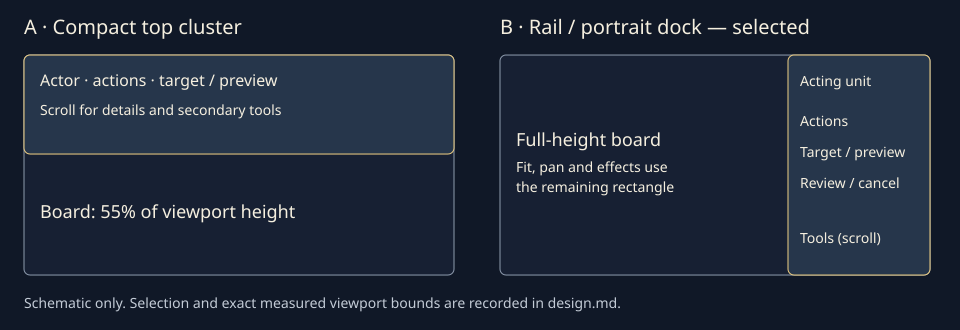

# Battle controls — design review

Status: **ready for design review; not yet accepted**. Issue [#108](https://github.com/luminari-gurus/tactics-guru-v2/issues/108). Source baseline: `d2a1a61abb636b5ab38ddce6c26207f6bcb6d4f5`, re-fetched 2026-10-14. The user's continuation request authorizes producing this package. Runtime integration belongs to [#111](https://github.com/luminari-gurus/tactics-guru-v2/issues/111), gated on acceptance of this design.

## Review entrypoint

Open [mockups.html](mockups.html) through the repository's Vite dev server, or directly from disk. The review toolbar selects all three heroes and each state. `?hero=fighter&state=idle&export=1` hides only the reviewer toolbar. Resize to 1280x720, 412x915 and 915x412. Player controls work within a small display-only demonstration; there is no battle simulation, persistence, audio playback or RNG in this file.

## Source contract

- [HUD](../../../src/ui/hud.ts): `BattleHud.render` owns acting-unit text, HP/max HP, Guarded and spent flags; `actionCommand` derives signatures from the catalog. Party buttons inspect without changing `session.active`. `previewText` formats legal previews and visible invalid reasons.
- [Catalog](../../../src/content/catalog.ts), [abilities](../../../src/content/abilities.ts), [combat](../../../src/domain/combat.ts): Fighter max HP 18, AC 14, accuracy +4, power 3; Ranger 12, 12, +5, 2; Mage 11, 11, +3, 4. All have movement allowance 4 and jump 1. Guarded adds 2 AC. Guarded Strike carries an attack penalty of 2; High Shot range is 2–5; Magic Missile range is 1–5 and one missile deals 2–5 force damage at caster level 1.
- [Session](../../../src/app/BattleSession.ts) and [scene](../../../src/phaser/BattleScene.ts): Move/Basic attack/signature prepare a preview, then Review opens confirmation. Cancel never dispatches. Wait prepares and confirms `endTurn` directly. `presenting` acknowledges an already accepted command, and only `finishPresentation(token)` changes the phase. UI timers must never unlock input.
- [Dialogs](../../../src/ui/dialogs.ts) and [persistence controls](../../../src/ui/persistence.ts): retain one native dialog owner, modal input capture, safe focus return, reset confirmation, current-save recovery and history behavior. Save accepted state before animation, preserve #106 effects and audio lifecycle.
- [BoardRenderer](../../../src/phaser/BoardRenderer.ts), [fitBoard](../../../src/geometry/iso.ts), [constrainView](../../../src/geometry/picking.ts): current geometry reserves everything below `panelBottom`; DOM movement alone cannot implement a side rail or bottom dock. Resizing a panel preserves navigation; real viewport changes refit and preserve relative zoom.

## Display fixtures and state catalogue

The three independent hero examples use illustrative current HP (Fighter 14/18, Ranger 9/12, Mage 7/11), sourced maxima/stats and catalog names. They are not snapshots of one legal playthrough. The context image is a separate real initial Forest Ruins board with its original units. It proves visual space, not correspondence between fixture HP/targets and board positions.

Primary order: **Acting unit → HP/status/budgets → four actions → selected target and preview → Review/Cancel**. Inspection appears in a separately titled detail dialog; the action owner stays visible beneath it and no inspection control says “select hero.” The selected target appears alongside its preview, never in the acting-unit heading.

- **Idle:** Your turn; Move ready, Action ready. Move, Basic attack, named signature and Wait / End turn enabled. Target and Review unavailable, with “Choose an action” text.
- **Action selected / target selection:** pressed button includes “Selected”; reachable target selector or board input produces a preview. Cancel clears intent. No auto-confirm.
- **Valid preview:** selected Goblin grunt 9/9 HP, AC 12 (or a movement destination), forecast and resource cost. Example level-ground Guarded Strike: 55% hit, +2 vs AC 12, 5 damage / 10 critical; High Shot: 70%, +5, 4 / 8; Magic Missile: automatic hit, 2–5 force. Basic attack uses each hero's accuracy/power. Values are illustrative and runtime must use `previewText`, never these constants.
- **Invalid target:** “Unavailable: out of range”; Review disabled, target replacement and Cancel available. Real implementation must preserve every authoritative rejection reason, including blocked line of sight, invalid/missing/defeated target and stale intent.
- **Review:** native Confirm action dialog repeats actor, action, target, forecast and cost. Confirm accepts once; Cancel/Escape clears the pending intent without spending anything. Restart remains available through the existing reset flow. Dismissal consumes the triggering gesture.
- **Movement spent:** Move disabled with visible “Spent”; attack/signature/Wait remain available. A move budget is one boolean, not invented remaining movement points.
- **Action spent:** Basic attack and signature disabled with visible “Spent”; Move and Wait remain available. Fighter example shows Guarded (+2 AC), effective AC 16. All other examples explicitly say no status effects.
- **Enemy turn:** acting identity is Goblin archer, HP 8/8, AC 11, accuracy +4. Hero actions/target/review/cancel disabled and explained. Inspection, log, sound and restart remain accessible.
- **Presenting:** accepted command is animating; all gameplay inputs stay locked. Static “Resolving action” text remains; no countdown, auto-unlock or synthetic command. The reviewer fixture selector alone advances this display example.
- **Victory / defeat:** ended banner plus native outcome dialog. Gameplay remains disabled after Escape; Restart opens reset confirmation. Log/inspection/sound/recovery remain available after dismissal.
- **Inspection:** separate “Inspection only — Ranger” dialog with HP, AC, accuracy, power, movement allowance, jump, dexterity/will and status. Close returns to the inspecting button. Actor does not change.
- **Error/recovery:** retain the existing fatal-error and storage recovery text through the same modal owner in runtime; no new storage state machine in the prototype. Save recovery is an explicitly labelled explanation of that integration seam.

## Placement decision

Two bounded options: a compact top cluster preserving `panelBottom`, and a right rail that becomes a portrait bottom dock. Choose the **rail/dock** for refinement: full-height board space in landscape, consistent action ownership, and a portrait dock reachable near the thumb. A top cluster at the existing 45% short-landscape cap leaves only 55% vertical board space and still needs scrolling for rich target/preview controls. The rail keeps controls beside the board rather than shrinking its height. This has a real geometry integration cost, detailed in the handoff; it is not a CSS-only runtime change.



At width ≥760px: 352px right rail. In short landscape (height ≤500px): 280px rail, shrinking to 244px at widths ≤640px. Portrait/narrow tall view: bottom dock capped at 56% of the safe viewport, 510px maximum; remaining height belongs exclusively to the board. The actor header stays in the dock while the action/preview/tools region scrolls. Its height is capped at 45% of the dock, with a separately focusable scroll region for large text/small screens. Enlarged text never enlarges the dock beyond its cap. The drawable board retains its minimum height; decorative captions yield space and scroll if necessary. The decorative board heading is omitted in small portrait (≤450px wide, ≤700px high).

Use safe-area insets on the outer layout, at least 8px inset and 12px separation. All expanded details use the native modal instead of growing over the board. Modal occlusion is deliberate, with gameplay captured; board floors apply to nonmodal states. Tool order is Inspect party, Battle log, Sound, Save recovery, Restart. Board controls/help sit with those secondary tools. No always-open diagnostics panel in the proposed player surface.

## Visual language and accessibility

Tactical fantasy, restrained brass lines over opaque midnight panels, existing painted portraits and the actual isometric board. Georgia headings give a modest book-like tone; system sans-serif carries controls and numbers. No external font, icon library or new art. Theme tokens use warm white `#f5efdf`, secondary `#c3cbd6`, brass `#f0cf83`, panel `#182335`, button `#26364b`, edge `#8d9bad`, positive `#a9ddb8`, warning `#ffc1ae`. Health uses both numbers and a bar. Selected, spent and locked states use explicit words as well as color/borders.

Controls use ≥44px dimensions, visible 3px brass focus and native names. Buttons state the resource cost; disabled explanations remain readable without focusing a disabled control. Native Tab/Shift+Tab order follows the content hierarchy; Enter/Space activates controls, select uses native arrows, Escape cancels intent or closes a dialog. Board focus is separately labelled with arrow/Enter/Escape instructions. The prototype's board is only a selectable context image; real cell navigation remains a runtime requirement. Announce actor/phase and preview via polite live regions; avoid repeated whole-panel announcements.

No nonessential animation in this prototype, so reduced motion is intrinsically supported. Runtime should retain static status/health/result feedback when reducing decorative transitions and must preserve authoritative phase completion. Contrast, dimensions, board bounds, modal focus, input capture and viewport results will be recorded below after browser verification.

## Rendered evidence and review disposition

Author review selected the rail/dock, inspected the three primary compositions, the smaller layouts, previews, confirmation and enlarged-text states, and repaired discovered prototype defects. Human design acceptance is pending in the PR. Screenshots and the clickable prototype are proposals for that review, not a claim of approval.

- Desktop / Fighter: [idle](previews/desktop.png), [Guarded Strike preview](previews/desktop-preview.png), [confirmation](previews/desktop-review.png).
- Portrait / Ranger: [idle](previews/portrait.png), [High Shot preview](previews/portrait-preview.png), [confirmation](previews/portrait-review.png).
- Landscape / Mage: [idle](previews/landscape.png), [Magic Missile preview](previews/landscape-preview.png), [confirmation](previews/landscape-review.png).
- Stress: [320x568](previews/small-portrait.png), [568x320](previews/small-landscape.png), [200% text actions](previews/small-portrait-text200.png), [200% text unit information after scrolling](previews/small-portrait-text200-info.png). Other viewport/state captures are alongside these files.
- Exact geometry, browser version, contrast pairs and result counts: [measurements.json](previews/measurements.json). Reproduction: [verify.mjs](verify.mjs).

Coordinates use CSS pixels from the top-left of the viewport. Outer reserved battlefield bounds and **drawable image/input region** are separate; captions are not counted toward the floor. Rounded initial-state drawable bounds:

- 1280x720: x13, y99.7, 890x569.5; **79.1%** viewport height. Right rail: x916, y12, 352x696.
- 412x915: x9, y73.7, 394x290.2; **31.7%**. Dock: below the battlefield, capped at 56% of the safe layout.
- 915x412: x9, y70.7, 609x302.5; **73.4%**. Right rail: x627, y8, 280x396.
- 320x568 and 568x320: the exact final rectangles are in the JSON; both meet the 30%/55% drawable-height floor. 200% text meets those floors in every tested viewport (Chromium subpixel rounding tolerance 0.02px).

The whole captured board, including all original unit silhouettes, is contained inside this region with `object-fit: contain`; the controls never overlap it. At small sizes this is an overview, not proof that each tile is a 44px touch target. The accessible target selector is the precise alternative; the runtime handoff must verify pan/zoom and actor/target/effect framing against the actual board. Modal states intentionally cover the scene while capturing input; they do not promise the nonmodal visibility floor.

**Measured contrast:** warm white/panel 13.75:1; secondary text/button 7.50:1; brass/selected button 6.88:1; dark text/brass primary button 10.49:1; control border/button 4.34:1; health green/panel 10.31:1; warning/panel 10.14:1; secondary text/lightest actor-gradient endpoint 7.43:1. The measured text pairs exceed 4.5:1 and the meaningful boundary pair exceeds 3:1. Decorative art, dimmed modal background and unavailable-control borders are not contrast-certified; disabled text remains readable at the ordinary secondary-text ratio. This is not a blanket accessibility conformance claim.

**Walkthrough:** installed Edge 155.0.4283.45 via repository Playwright, headless, device scale 1; no Browser skill/plugin was listed. File URL entrypoint ensures the package also works without a server. `PLAYWRIGHT_CHROMIUM_EXECUTABLE` selects the installed browser; otherwise the script uses Playwright's configured default Chromium. Run from the repository:

```powershell
$env:PLAYWRIGHT_CHROMIUM_EXECUTABLE='C:/Program Files (x86)/Microsoft/Edge/Application/msedge.exe'
node docs/ongoing-projects/issue-108-battle-controls-design/verify.mjs
```

Passed 180 cases (3 heroes × 12 states × 5 viewports), plus reviewer-toolbar navigation in each viewport. All images loaded; page identity/meaningful content, no horizontal page overflow, ≥44px buttons/selects, no board/control overlap, phase locks and disabled states passed. Each viewport exercised three action→target→Review→Confirm paths, invalid target, immediate Wait without a dialog, Escape cancellation, native Tab/Shift+Tab modal capture, pointer/tap/drag against the modal backdrop, inspection without actor change, sound display toggle, restart, actual board activation, scrolling at 200% text and synthetic 24/24/34/24px safe insets. No page or console errors were captured. Board inputs increment only for board activation; UI/modal/dismissal gestures leave the counter unchanged. No nonessential motion exists; the prototype does not auto-unlock presentation.

Repairs during verification: cancellation now restores focus **after** its state-changing callback, falling back to Restart when Review is disabled; bounded actor scrolling prevents enlarged text from consuming the action area; drawable-board minima prevent oversized captions consuming the battlefield. Enemy states explicitly label the disabled player action owner; defeat shows zero HP; inspection of a Guarded fighter retains effective AC/status.

The same cancellation focus defect was separately reproduced on the unmodified live baseline: Move → target → Review → Escape left `document.activeElement` as BODY with Review disabled. It is repaired in separate [PR #113](https://github.com/luminari-gurus/tactics-guru-v2/pull/113); no game source is changed by this design package.

## Acceptance map

1. Three mockups, hierarchy and responsive rules: the desktop/portrait/landscape evidence above and Placement decision.
2. Three heroes and named signatures: idle/preview captures and all hero options in the [prototype](mockups.html).
3. Actor versus inspection/target: Inspection fixture, persistent actor header, explicit target label and actor-invariance interaction assertions.
4. Complete states: Display fixtures and state catalogue; all 12 toolbar states checked at each size/hero.
5. At-a-glance decisions and disabled feedback: idle/spent/invalid/locked fixtures, numerical HP, status and budget text, and persistent reasons independent of hover.
6. Accessibility: Visual language, measured contrast, target/focus/scroll/keyboard checks and enlarged-text captures.
7. Board visibility/input capture: annotated rectangles above, measurement JSON and real pointer/tap/drag counter assertions. This verifies only the prototype.
8. Chosen design and scoped handoff: author-review disposition and [implementation issue #111](https://github.com/luminari-gurus/tactics-guru-v2/issues/111), created after checking for an existing matching item and read back with its explicit #108 acceptance dependency. It is intentionally not labelled ready for work.

## Runtime implementation handoff

Implement only after the design review is accepted. Reuse existing architecture; one native DOM HUD connected to `BattleSession`, no second simulation or framework. Open an implementation OpenSpec change against `battle-controls`; preserve all current behavioral requirements.

1. **HUD/shell:** update `src/ui/hud.ts`, `src/style.css` and `index.html`. Keep `#battle-controls`, `#battle-party`, `#battle-active`, `[data-action=move|basic|signature]`, `#battle-move`, `#battle-next`, `#battle-target`, `#battle-selection`, `#battle-preview`, `#battle-review`, `#battle-cancel`, `#battle-log`, `#battle-sound`, `#battle-sound-retry`, `#battle-save-status`, `#battle-recovery` and `#fit-restart` where practical. Action names may present the catalog name directly while preserving the intent hook; update exact-name tests deliberately. Inspect must read live unit data without overwriting action preview/actor state. The prototype's short IDs are documentation-only and must not replace runtime selectors.
2. **Camera/geometry:** in `BattleScene`, observe the actual drawable board region, excluding safe insets and captions. Pass one `{x,y,width,height}` rectangle to `BoardRenderer.fit`, `fitBoard` and `constrainView`, replacing `panelBottom`. Center and clamp in that rectangle; keep existing fit padding, min/max zoom and navigation-preservation behavior. Refit on actual orientation/viewport changes, not on every status-text update. Keep target/unit/effect anchors within the drawable region, including raised tiles and #106 labels. Do not implement a generalized overlay registry.
3. **Input/modals:** preserve `BoardInput`'s pointer ownership, drag threshold, cancellation and phase gating. The DOM controls consume their own gestures; the active drawable rectangle excludes the rail/dock. Existing modal transitions reset obsolete gestures. Reuse `BattleDialogs` for review, inspection, log, outcome, recovery and reset; apply the separate focus-order repair. Closing a dialog that opens another must never move focus outside the new dialog. Restore to a usable invoker or Restart after the callback finishes.
4. **State/lifecycle:** use actual `previewText`/rejection reasons, `hasMoved`/`hasActed`, current HP, Guarded and catalog fields. Wait remains immediate. Preserve accepted-command autosave before presentation, token-based unlock, restart/history cancellation, current-save resume and audio ownership. Save/recovery remains the existing implementation; the prototype explanatory dialog does not define replacement storage behavior.
5. **Proof:** extend `tests/battle-loop.spec.ts` for hierarchy, separate inspection, disabled reasons, modal focus/capture and keyboard/touch parity; `tests/battle-board.spec.ts` and existing geometry unit tests for available rectangles, fit/zoom/orientation and transformed selection; retain `battle-animations`, `battle-persistence`, `battle-audio` and authored-encounter checks. Run configured unit/content/browser suites including encounter posttest, both typechecks, production build, strict OpenSpec and diff checks. Record actual outcomes, revisions and device limits; no physical claims from emulation.

Limits: no live HUD redesign, combat/save/animation changes, actual prototype audio, physical iOS/Android verification, screen-reader audit or deployment. The board image is an unmodified browser capture of baseline `d2a1a61` with the HUD hidden before initial fit (1000x760; board bounds x16–984, y118.09–641.91); illustrative hero/state controls do not describe that captured battle. #57/#58/#64/#66/#74 retain their own acceptance.
